# Zero Trust Identity Lab: Conditional Access, PIM and Access Reviews


How I moved a Microsoft 365 lab tenant from Security Defaults to enforced Conditional Access, run the way I'd run it at work: tested before enforcing, rolled out in stages, kept as code, and monitored. The first part explains the problem, what I did and what I learned. The second part is a full guide to build it yourself.

**Full write-up on Medium:** [How I rolled out Conditional Access without locking anyone out](https://medium.com/@brightkakatech/how-i-rolled-out-conditional-access-without-locking-anyone-out-report-only-rollout-rings-pim-ci-ac6c854b1fbd)

**Built with:** Microsoft Entra ID (Conditional Access, PIM, Access Reviews, dynamic groups), Microsoft 365, PowerShell 7, Microsoft Graph, Pester, GitHub Actions, Azure Monitor, Log Analytics, KQL.

**Scope:** a lab tenant with trial licences, 4 real test accounts and 150 synthetic staff. I played every role (requester, approver, admin, user), so the process is real but the scale is simulated.

## The problem

Most Microsoft 365 compromises start with an identity: a phished password, an admin account that is always on, a leaver who still has access. Security Defaults is a good start for a small company, but it is all or nothing, can't be tuned, and when it blocks someone it doesn't say why.

In a bigger organisation the hard part isn't creating Conditional Access policies. It's changing how thousands of people sign in without locking anyone out, and being able to show afterwards what was enforced, on whom and when. That's what I wanted to practise here.

These are also the controls auditors and cyber insurers usually ask about: MFA for everyone, restricted admin access, and regular access reviews.

## What I delivered

| Result | Evidence |
|---|---|
| 4 Conditional Access policies enforced for **all users**, after 8 days in report-only and a two stage rollout | [Stage 8](#stage-8-enforce-in-stages) |
| MFA enforced from Ireland, sign-in **blocked** from the United States | Recordings in [Stage 8](#stage-8-enforce-in-stages) |
| Admin rights only **just in time** with PIM | [Stage 4](#stage-4-just-in-time-admin-with-pim) |
| Quarterly **access review**, with a stalled auto-apply found and fixed | [Stage 5](#stage-5-access-review) |
| **150 synthetic staff** and 11 **dynamic groups**, created by script and tested first | [Stage 6](#stage-6-scale-synthetic-staff-and-rollout-rings) |
| Policies as code, with **CI blocking** a change that removes the break-glass exclusion | [Stage 7](#stage-7-policies-as-code-with-ci-guardrails) |
| **Critical alert email** on any break-glass sign-in | [Stage 9](#stage-9-alert-on-every-break-glass-sign-in) |
| 6 of 7 planned tests passed (the 7th needs Intune), plus 62 automated tests in CI | [Test results](#test-results) |

## See it working

From Ireland, a user is asked for MFA and gets in:

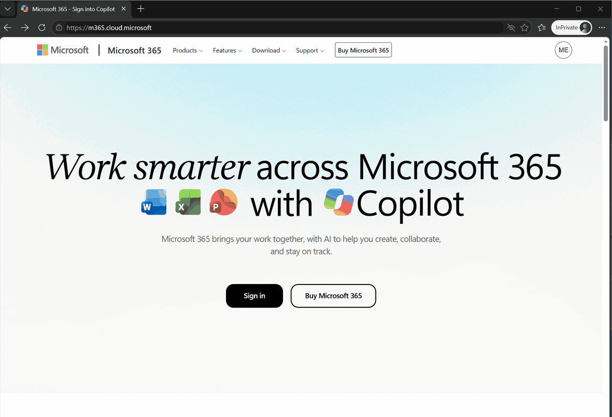

Through a United States VPN, the same user with the same password is blocked:

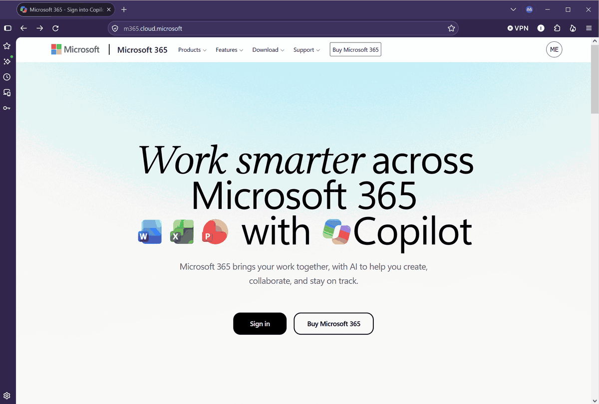

A pull request that quietly removes the emergency account exclusion is stopped by CI:

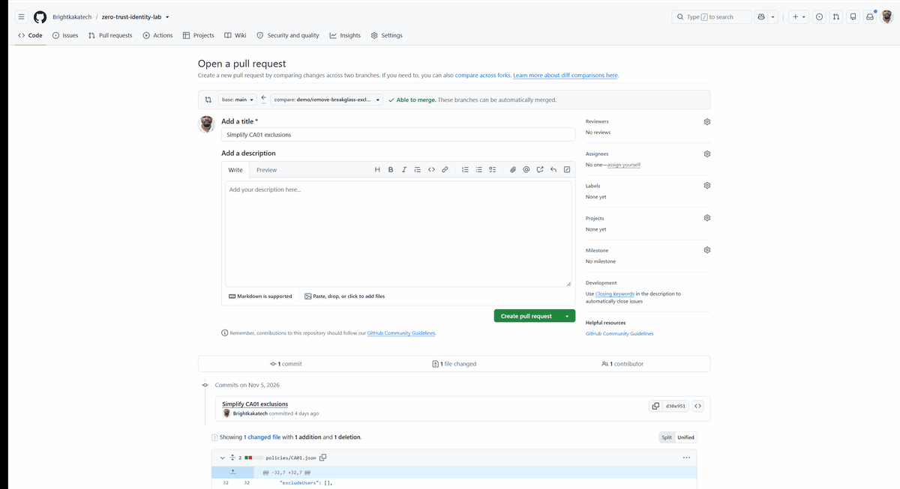

An emergency account signs in, and a critical alert email follows:

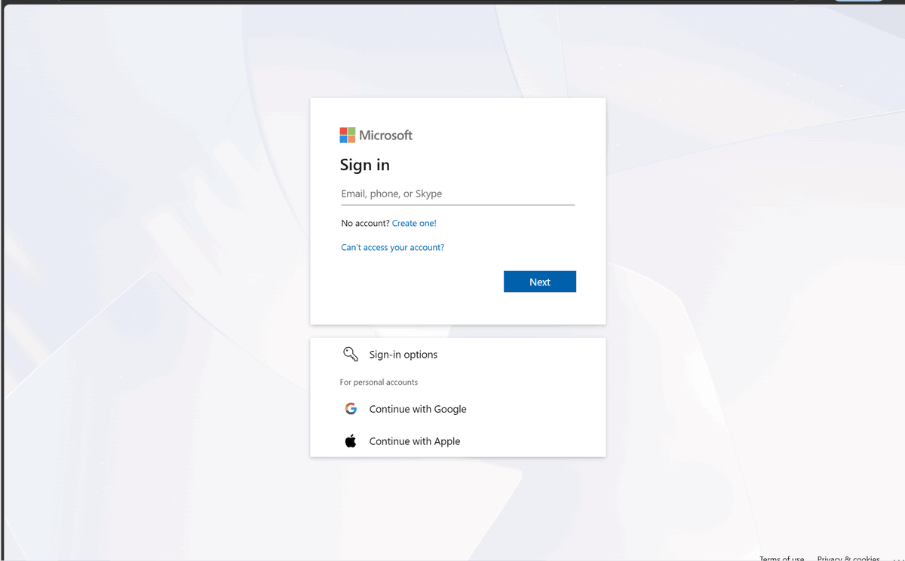

## Architecture

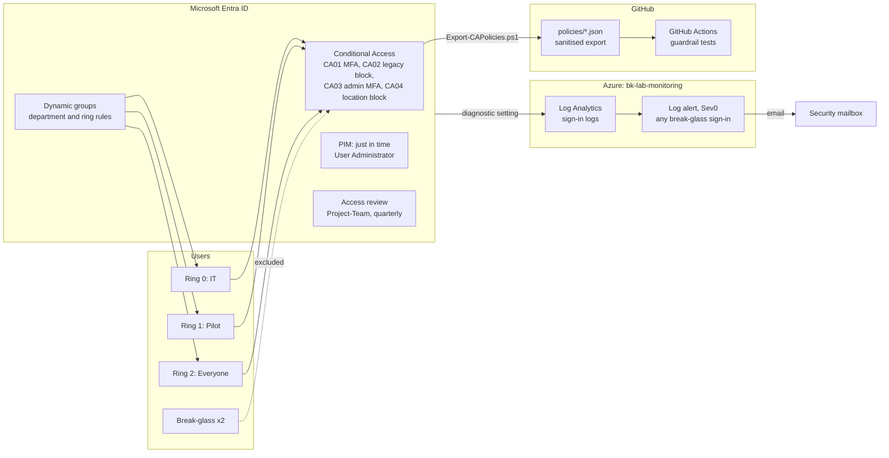

## Decisions I made, and why

| Decision | Why |
|---|---|
| Created the break-glass accounts before any policy | A broken policy with no way back in is an outage, not a lab mistake |
| Kept Security Defaults on during report-only | Report-only can run alongside it, so the tenant was never unprotected while testing |
| Declined the portal's offer to exclude my own admin account | Lockout protection comes from monitored break-glass accounts. The daily admin should be covered like everyone else |
| Ran an impact report before every enforcement | Decisions based on sign-in data, not on "it looked fine" |
| Rings first, then **All users**, not the Ring 2 group | Rings stage a rollout. Leaving policies on ring groups would leave anyone without a ring, such as a new starter, unprotected |
| Blocked legacy authentication for everyone at once | Zero legacy sign-ins in the logs, so staging it would add risk without benefit |
| Group owners as access reviewers | It scales. One admin cannot meaningfully review hundreds of groups |
| "No change" if a reviewer doesn't respond | A forgotten review shouldn't remove someone's access |
| Alerted on non-interactive sign-ins too | A stolen token never types a password, so it only appears there |
| Excluded one exact, documented sign-in pattern from the alert | My phone refreshing the passkey session was constant noise. Excluding only that pattern kept every other case covered |
| Owner on the Azure subscription as time bound, not PIM eligible | The P2 trial ends before the project does, and an eligible role I couldn't activate would lock me out of my own monitoring |

## What broke and what I learned

- **The access review said "denied", but the user kept access for six days.** Auto-apply stalled. I only found it by checking the group itself, not the review status. Since then I verify outcomes, not statuses.
- **The alert fired four times and nobody got an email.** The recipient address had never been verified, and Azure skipped it silently. Detection that nobody hears about isn't monitoring.
- **My first policy export leaked an ID that my tests didn't check for.** I found it by reading the file, fixed the export and added a test, so it can't happen again.
- **A red check didn't stop the merge.** CI flagged the bad pull request, but the Merge button stayed clickable. A test nobody is forced to pass is only advice, so `main` now has a ruleset that requires it, with no bypass for admins.
- **Security Defaults blocked a new user with no explanation** (error 530035). It's the clearest argument for Conditional Access: every decision is visible, per policy, per sign-in.
- **The emergency accounts kept "signing in" from my phone.** Passkeys in Authenticator keep a session alive. I excluded only that exact pattern and noted the real fix: hardware security keys.

More findings in each stage's write-up under [docs/](docs).

# Build it yourself

Everything below is a step by step guide to building the same lab, with the exact steps, commands and checks I used.

## New to this?

You don't need to be an expert, but it helps to have used the Microsoft 365 admin center and run a few PowerShell commands. Plan for about 8 to 10 evenings of 2 to 3 hours, mostly spent testing and waiting for logs. A few terms used throughout:

| Term | Meaning |
|---|---|
| Conditional Access | Rules that decide what happens at sign-in: allow, ask for MFA, or block |
| Report-only | A policy is evaluated and logged, but not enforced. Safe for testing |
| Break-glass account | An emergency admin account excluded from every policy, used only if everything else fails |
| PIM | Privileged Identity Management: admins request their role for a short time instead of holding it all the time |
| Dynamic group | A group whose members are added and removed automatically by a rule, such as department equals Finance |
| KQL | Kusto Query Language, used to search logs in Log Analytics |

## Before you start

| Item | Detail |
|---|---|
| Tenant | A **lab** Microsoft 365 tenant, never a production one. I used a Microsoft 365 Business Premium trial (includes Entra ID P1 for Conditional Access). Set its renewal to **Cancel on expiration** straight away |
| Entra ID P2 | 30 day trial, for PIM and access reviews (Stage 4). Also set to cancel on expiration |
| Azure subscription | Pay-as-you-go, **in the same tenant**, for Log Analytics (Stage 9). Expected cost under EUR 2 a month with a EUR 5 budget alert |
| Tools | Edge, PowerShell 7, Microsoft Graph PowerShell SDK (`Microsoft.Graph.Authentication`, `.Users`, `.Groups`), Pester 5, Git, a GitHub account |
| A phone | Microsoft Authenticator, for MFA and the break-glass passkeys |
| Recording | ScreenToGif at 10 fps, for the demos |

Install the PowerShell modules once, **in PowerShell 7** (not Windows PowerShell 5.1, which keeps its modules separately):

```powershell
Install-Module Microsoft.Graph.Authentication, Microsoft.Graph.Users, Microsoft.Graph.Groups -Scope CurrentUser
Install-Module Pester -MinimumVersion 5.5.0 -MaximumVersion 5.99.99 -Scope CurrentUser -Force -SkipPublisherCheck
```

**Getting a lab tenant:** sign up for a Microsoft 365 Business Premium free trial on the Microsoft 365 website with a new admin account. This creates a new tenant (`<name>.onmicrosoft.com`). It needs a card, so set the subscription to cancel on expiration on day one (Microsoft 365 admin center → Billing → Your products).

**Fork** this repo on GitHub (so GitHub Actions runs on your copy), then clone your fork and unblock the scripts after reading them (Windows blocks downloaded scripts under the RemoteSigned policy, and the fix is to trust the reviewed files, not to weaken the policy):

```powershell
git clone https://github.com/<your-account>/zero-trust-identity-lab.git
cd zero-trust-identity-lab
Get-ChildItem .\scripts, .\tests -Filter *.ps1 | Unblock-File
```

**Adapt it to your tenant before you run anything:**

| File | What to change |
|---|---|
| `queries/breakglass-signin-detection.kql` | The two break-glass addresses |
| `policies/rollout-approvals.json` | Empty the `approvals` list. You add your own when you enforce (Stage 8) |
| `policies/CA0*.json` | Leave them for now. Your own export in Stage 7 overwrites them |
| Script parameters | Pass your domain with `-Domain <tenant>.onmicrosoft.com` |

Keep the group names (`CA-Exclude-BreakGlass`, `DYN-Ring0-IT` and so on) as they are, because the tests check for them.

## Stage 1: Lab tenant and break-glass accounts

**Why first:** Conditional Access can lock everyone out, including you. Before writing a single policy, create two emergency accounts that every policy will exclude.

**Starting point:** the tenant is protected by Security Defaults (Entra admin center → Overview → Properties → Manage security defaults).

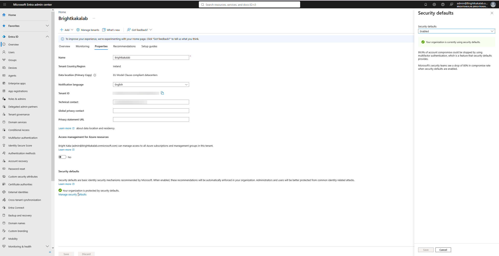

**Steps**

1. **Entra admin center → Users → New user → Create new user**: `breakglass01@<tenant>.onmicrosoft.com`, display name `Emergency Access 01`. Repeat for `breakglass02`.
2. Assign each the **Global Administrator** role as an **active permanent** assignment (not PIM eligible: activation could fail during an outage).
3. **Groups → New group**: Security group `CA-Exclude-BreakGlass`, add both accounts. Every policy will exclude this one group.
4. **Authentication methods → Policies → Passkey (FIDO2)**: check passkeys are enabled (they are by default in new tenants).
5. Sign in as each break-glass account at **mysignins.microsoft.com → Security info → Add sign-in method → Passkey**, and register it. Use **Edge**: Firefox only offered a USB key.
6. Create test users `alice`, `bob` and `helpdesk`, each with a licence and a usage location, and a group `CA-Pilot-Users` with Alice and Bob.

**Check**

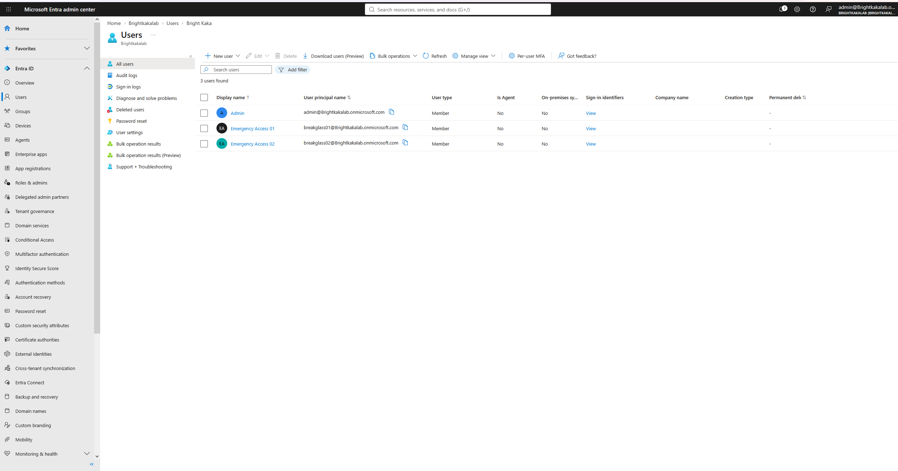

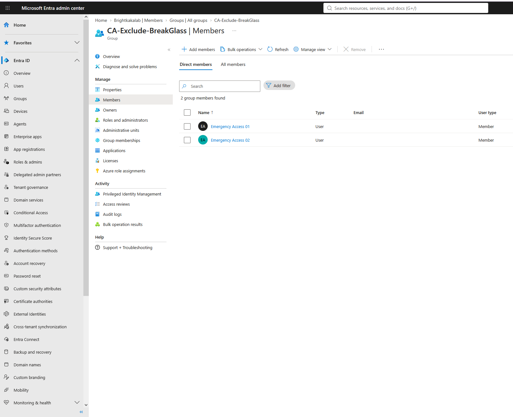

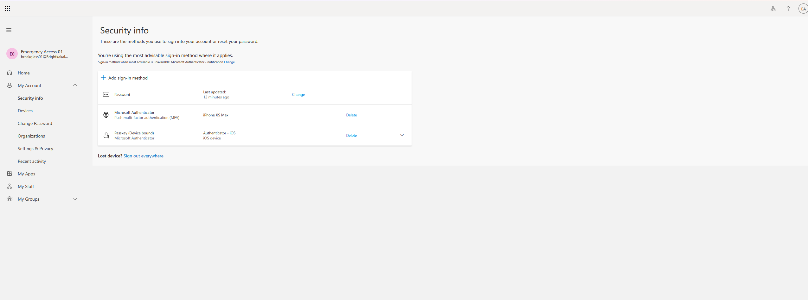

> In production, break-glass passkeys live on **hardware FIDO2 keys** in separate safes. In this lab both are in Authenticator on one phone, which is a documented deviation. Full design: [ca-policy-plan.md](docs/ca-policy-plan.md#break-glass-account-design).


---

## Stage 2: Create the four policies in report-only

**Why report-only:** policies are evaluated on every sign-in, but nothing is enforced. You see the effect before anyone is affected. Report-only can run while Security Defaults stays on, so there is no unprotected gap.

**Steps:** first create the named location, then the policies.

1. **Conditional Access → Named locations → Countries location**: name `Allowed countries: IE, UK`, tick Ireland and United Kingdom.

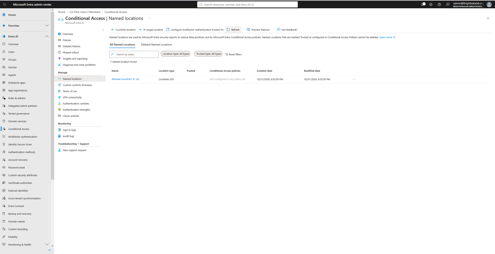

2. **Conditional Access → Policies → New policy**, four times:

| ID | Name | Users | Target resources | Conditions | Grant |
|---|---|---|---|---|---|
| CA01 | Require MFA for all users | All users, exclude CA-Exclude-BreakGlass | All resources | None | Require MFA |
| CA02 | Block legacy authentication | All users, exclude CA-Exclude-BreakGlass | All resources | Client apps: Exchange ActiveSync, Other clients | Block |
| CA03 | Require MFA for admins | 13 admin directory roles ([list](docs/ca-policy-plan.md#policies)), exclude CA-Exclude-BreakGlass | All resources | None | Require MFA |
| CA04 | Block sign-in from outside Ireland and the UK | All users, exclude CA-Exclude-BreakGlass | All resources | Locations: include Any, exclude `Allowed countries: IE, UK` | Block |

3. For each, set **Enable policy: Report-only** and **Create**.

When the portal offers to exclude your own admin account, **decline**: lockout protection comes from break-glass, and the daily admin must stay covered.

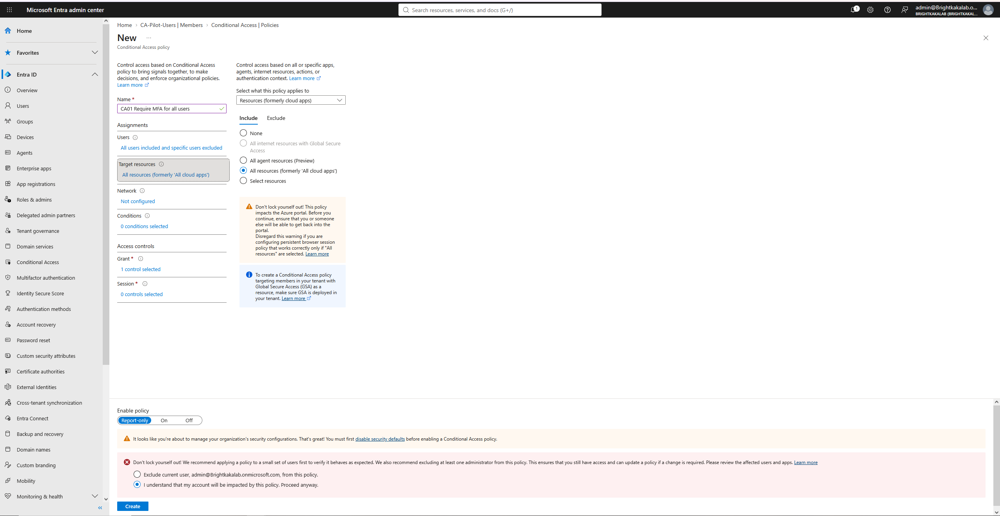

**Check**

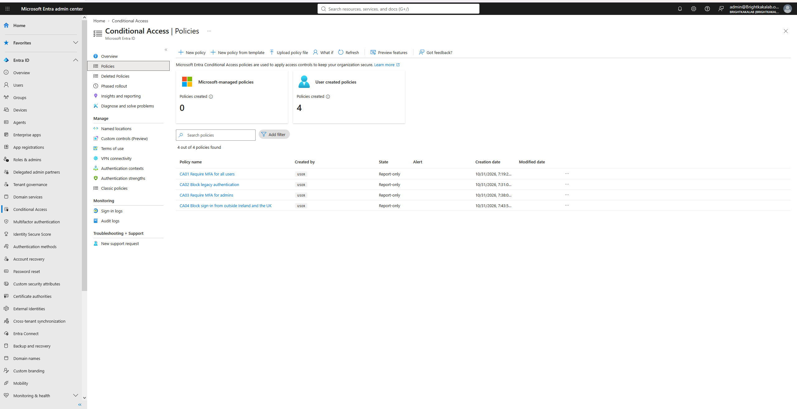

Full reasoning for every policy: [ca-policy-plan.md](docs/ca-policy-plan.md).


---

## Stage 3: Test before enforcing

**Steps**

1. **What If** (Conditional Access → Policies → What If): user Alice, app Office 365 Exchange Online, platform Windows, client Browser, IP `40.77.182.32`, country United States. Expected: CA01 and CA04 apply, and Block wins.

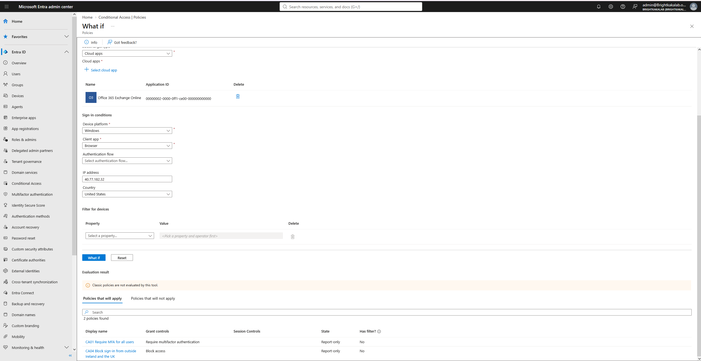

2. Repeat for `breakglass01`. Expected: **no policy applies**, reason "Users and groups".

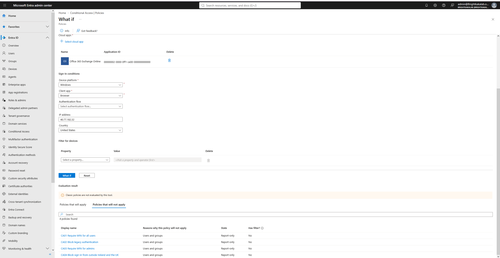

3. Sign in as Alice and Bob in an InPrivate window. Then **Sign-in logs → the sign-in → Report-only tab**. Note: the "Conditional Access" column only reflects policies that are On, so report-only results live on this tab.

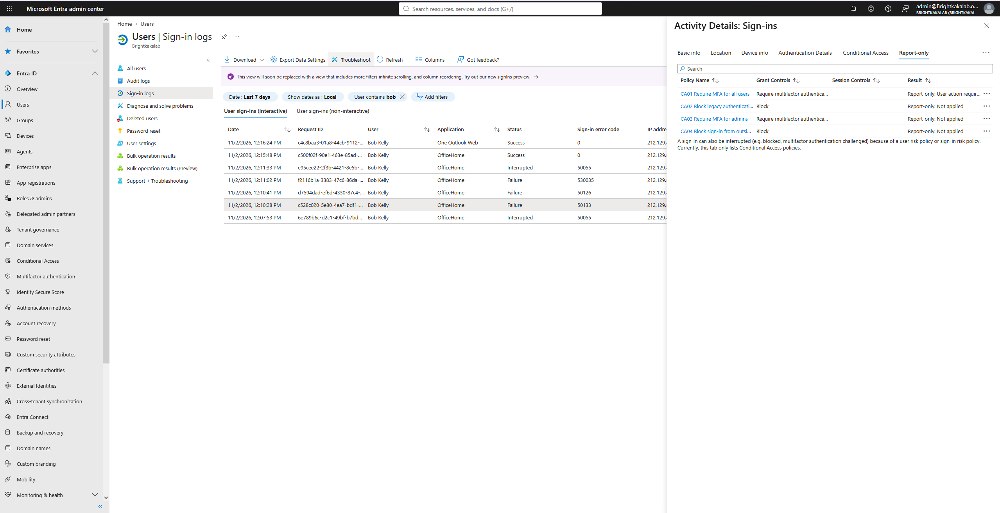

**What I found:** a new user's first sign-in failed once with **530035**, "blocked by security defaults", with no further detail. Security Defaults cannot explain or tune its decisions, while Conditional Access shows every policy's result on every sign-in. Full test log: [ca-policy-plan.md](docs/ca-policy-plan.md#test-cases-and-expected-results).


---

## Stage 4: Just in time admin with PIM

**Why:** an always active admin role is always available to an attacker. With PIM, HelpDesk is only **eligible** and activates the role when needed.

**Steps**

1. Start the **Entra ID P2** trial (Microsoft 365 admin center → Marketplace). It converts to paid by default: go to **Billing → Your products → Cancel on expiration** immediately. Assign P2 only to the users who need it, never to break-glass.
2. Confirm HelpDesk has no roles (Users → HelpDesk → Assigned roles). Do **not** use "Add assignments" there: it creates a permanent active role that bypasses PIM.

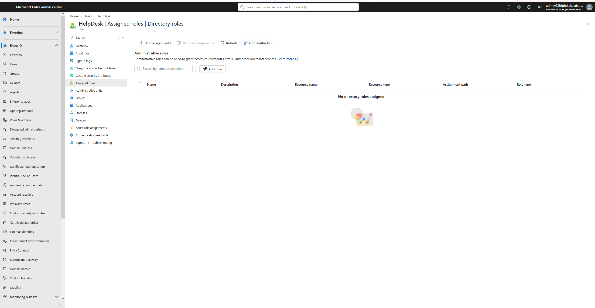

3. **ID Governance → Privileged Identity Management → Microsoft Entra roles → Settings → User Administrator → Edit**:
   - Activation: maximum **1 hour**, require **Azure MFA**, **justification** and **ticket information**.
   - Assignment: no permanent eligible or active assignments, eligibility expires after **6 months**.

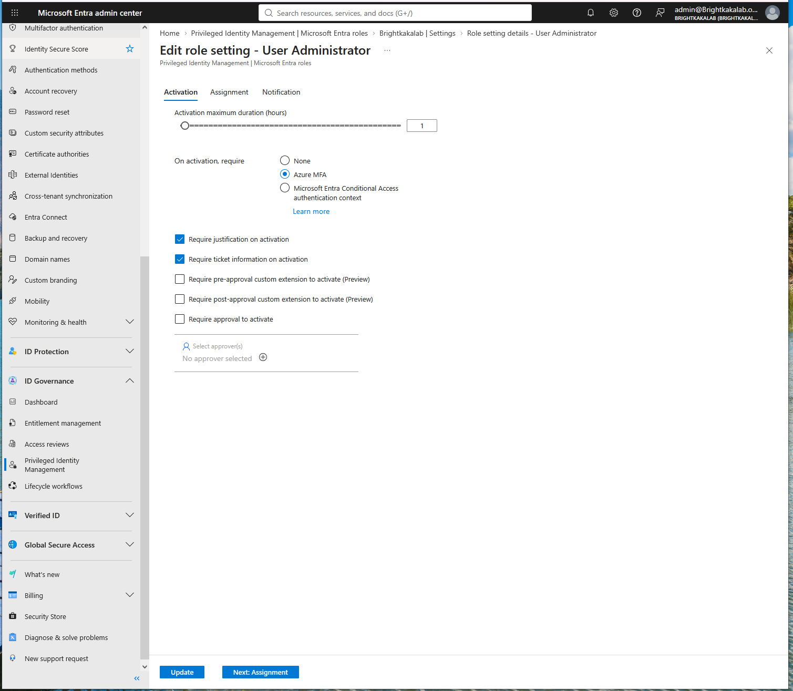

4. **Assignments → Add assignments**: role User Administrator, member HelpDesk, type **Eligible**.

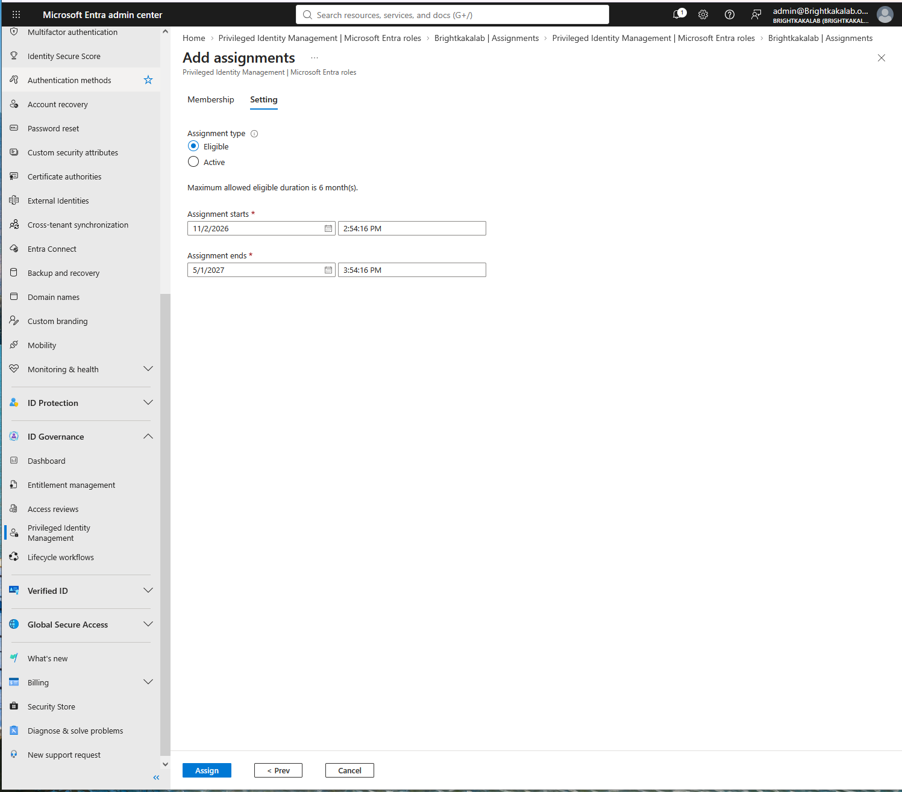

**Check:** sign in as HelpDesk → PIM → My roles → **Activate**, with a reason and a ticket number.

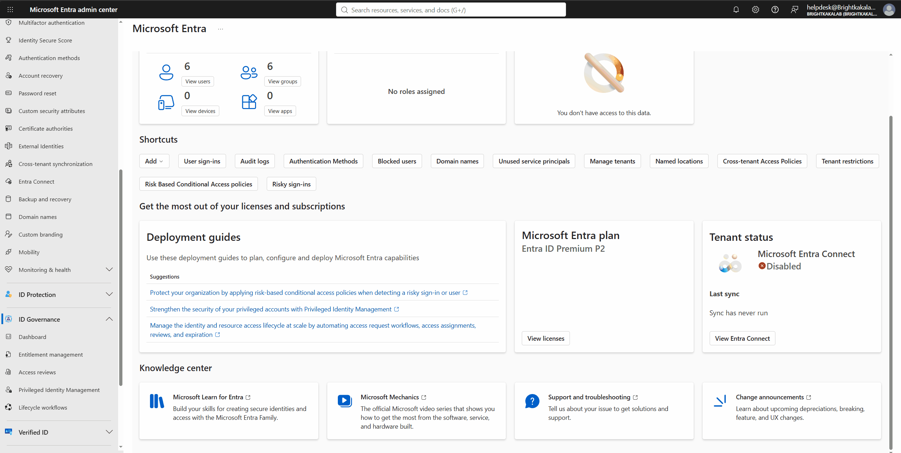

The admin policy CA03 applied only once the role was active (test T4):

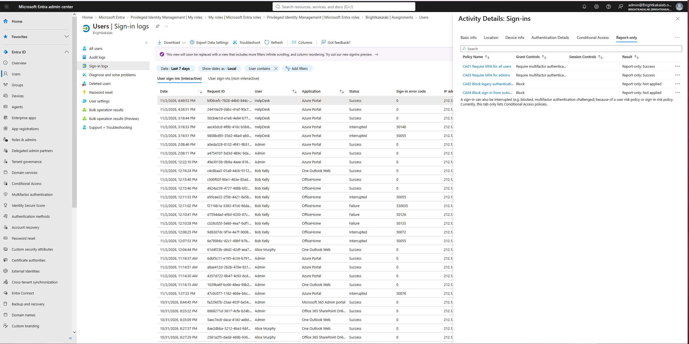

Details and findings: [pim-setup.md](docs/pim-setup.md).


---

## Stage 5: Access review

**Why:** people collect access over time. A review asks the group owner, on a schedule, whether each member still needs it.

**Steps**

1. Create a Microsoft 365 group `Project-Team`, owner Admin, members Alice, Bob and HelpDesk.
2. **ID Governance → Access reviews → New access review**: Teams + Groups, Project-Team, all users. Reviewers: **group owners**, fallback Admin. Duration 3 days, **quarterly**, no end. Auto-apply **on**, if no response **no change**, decision helper "no sign-in within 30 days", justification **required**.

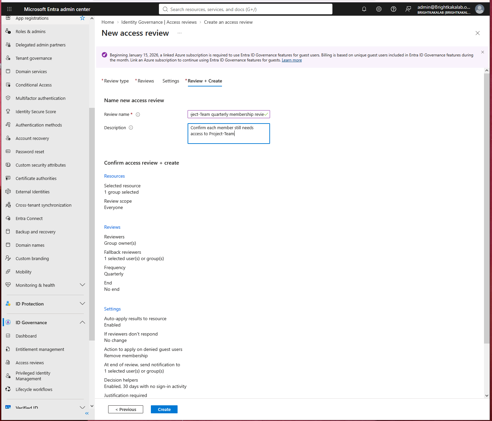

3. As the reviewer, open **myaccess.microsoft.com → Access reviews**. Approve Alice and Bob, **deny HelpDesk** with a reason, even though the system recommends approving him. Do not use "Accept recommendations".

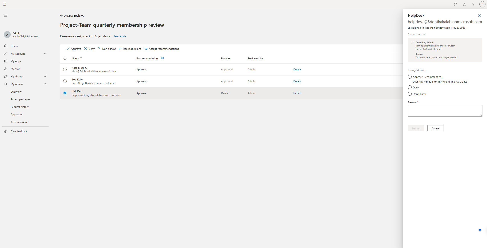

**Check the outcome, not the status.** In my run the review sat on "Applying" for six days and HelpDesk kept his access. Listing the group's members found it, and he was removed manually with a narrow Graph permission:

```powershell
Connect-MgGraph -Scopes GroupMember.ReadWrite.All, Directory.Read.All -NoWelcome
$team = Get-MgGroup -Filter "displayName eq 'Project-Team'"
$helpdesk = Get-MgUser -UserId "helpdesk@<tenant>.onmicrosoft.com"
Remove-MgGroupMemberDirectoryObjectByRef -GroupId $team.Id -DirectoryObjectId $helpdesk.Id
```

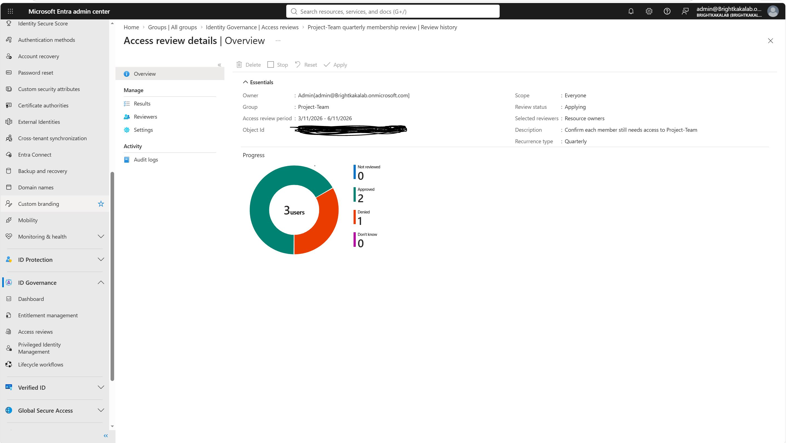

Timeline and findings: [access-review.md](docs/access-review.md).


---

## Stage 6: Scale: synthetic staff and rollout rings

**Why:** rollout rings and impact reports mean nothing with three users. This stage creates a fictional company of 150 staff and builds the rings from their attributes.

**Steps**

1. Test the data first (no tenant needed): 12 checks on uniqueness, labels, departments and ring sizes.

```powershell
Invoke-Pester -Path .\tests -Output Detailed
```

2. Preview, then create the users. Every account is **disabled**, has a random password nobody sees, and is labelled synthetic in three places. Running it twice creates no duplicates.

```powershell
.\scripts\New-LabUsers.ps1 -Domain <tenant>.onmicrosoft.com -WhatIf
Connect-MgGraph -Scopes User.ReadWrite.All -NoWelcome
.\scripts\New-LabUsers.ps1 -Domain <tenant>.onmicrosoft.com
```

3. Create the 11 dynamic groups (8 departments, 3 rings) defined in [data/dynamic-groups.json](data/dynamic-groups.json):

```powershell
Connect-MgGraph -Scopes Group.ReadWrite.All -NoWelcome
.\scripts\New-LabDynamicGroups.ps1 -WhatIf
.\scripts\New-LabDynamicGroups.ps1
```

4. Put the real test users into rings (Admin and HelpDesk in Ring 0, Alice and Bob in Ring 1):

```powershell
$rings = @{ 'admin' = 'Ring0'; 'helpdesk' = 'Ring0'; 'alice' = 'Ring1'; 'bob' = 'Ring1' }
foreach ($name in $rings.Keys) { Update-MgUser -UserId "$name@<tenant>.onmicrosoft.com" -OnPremisesExtensionAttributes @{ ExtensionAttribute1 = $rings[$name] } }
```

**Check:** dynamic groups fill in the background, from minutes to longer. Never use one in a policy before checking its count.

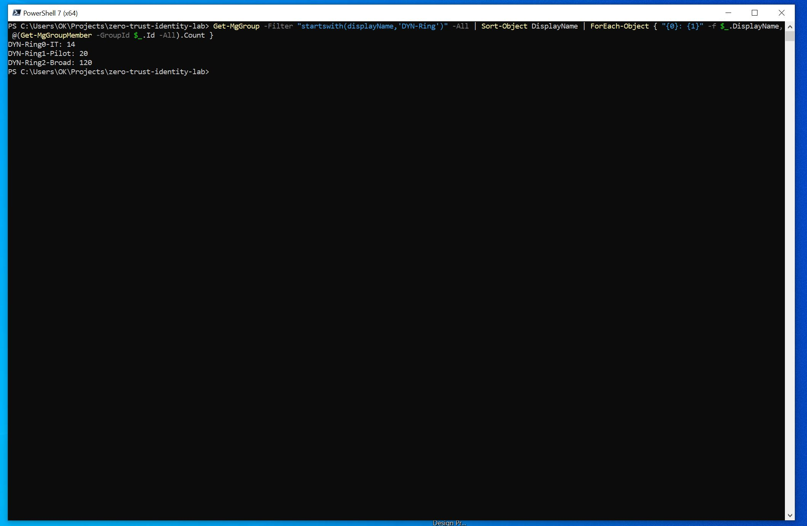

Details: [synthetic-users.md](docs/synthetic-users.md), [dynamic-groups.md](docs/dynamic-groups.md).


---

## Stage 7: Policies as code with CI guardrails

**Why:** a policy edited badly in the portal is only noticed during an outage. Exporting policies to Git and testing them on every change catches the mistake first.

**Steps**

1. Export the policies to sanitised JSON (IDs replaced by names, Graph metadata removed):

```powershell
Connect-MgGraph -Scopes Policy.Read.All, Directory.Read.All -NoWelcome
.\scripts\Export-CAPolicies.ps1
Select-String -Path .\policies\CA*.json -Pattern '@odata|[0-9a-f]{8}-[0-9a-f]{4}-'   # must print nothing
```

2. Run the guardrails locally. Every policy must exclude break-glass, follow the naming rule, never be left disabled, and only be On with an approval in [policies/rollout-approvals.json](policies/rollout-approvals.json).

```powershell
Invoke-Pester -Path .\tests -Output Detailed
```

3. Push. [.github/workflows/test.yml](.github/workflows/test.yml) runs a style check and all tests on every push and pull request.

**Check:** prove the guardrail works. I opened a pull request that removed the break-glass group from CA01:


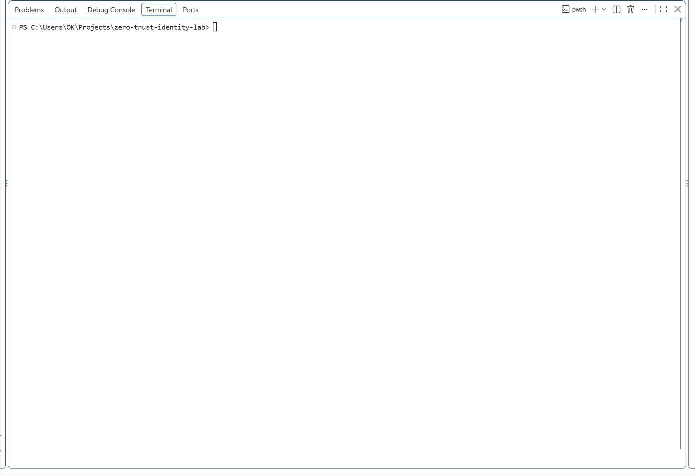

Close the test pull request without merging.

4. Make the check required. On its own, CI only reports: the failing check above still left the Merge button clickable. In **Settings → Rules → Rulesets**, create a branch ruleset on the default branch that requires a pull request and the `test` status check, with an empty bypass list. From then on, nothing reaches `main` without passing the guardrails, including my own changes.

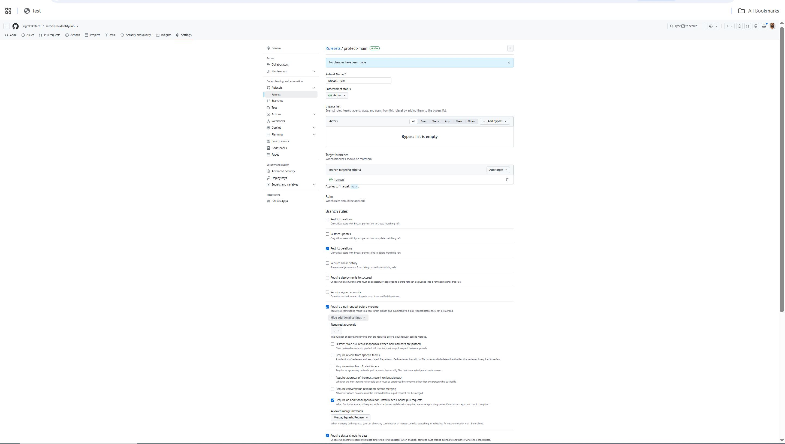

Details: [policies-as-code.md](docs/policies-as-code.md).


---

## Stage 8: Enforce in stages

**Why:** switching a policy On for everyone at once is how outages happen. Measure the impact, start with IT and pilot users, then widen.

**Steps**

1. Generate the impact report for the first target ring. It reads 7 days of sign-ins and checks that every enabled user in the ring has MFA registered, then prints GO or REVIEW:

```powershell
Connect-MgGraph -Scopes AuditLog.Read.All, Directory.Read.All -NoWelcome
.\scripts\Get-CAImpactReport.ps1 -TargetGroup DYN-Ring1-Pilot
```

2. Write the change record ([CHG-001](docs/changes/CHG-001-enforce-conditional-access-ring0-ring1.md)) and add the approvals to `rollout-approvals.json`.
3. Change CA01 and CA04 to include only **DYN-Ring0-IT** and **DYN-Ring1-Pilot** (keep the break-glass exclusion).

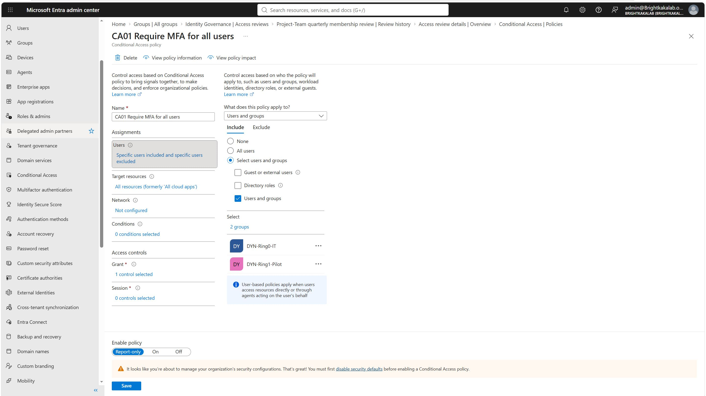

4. Turn off Security Defaults (Overview → Properties → Manage security defaults → Disabled, reason "My organization is using Conditional Access"), then **immediately** switch CA01 to CA04 to **On**.
5. Export, run the tests (the approval test now runs instead of skipping), commit and push.

**Check:** from Ireland, Alice is asked for MFA:


Through a United States VPN, the same user is blocked (error 53003):


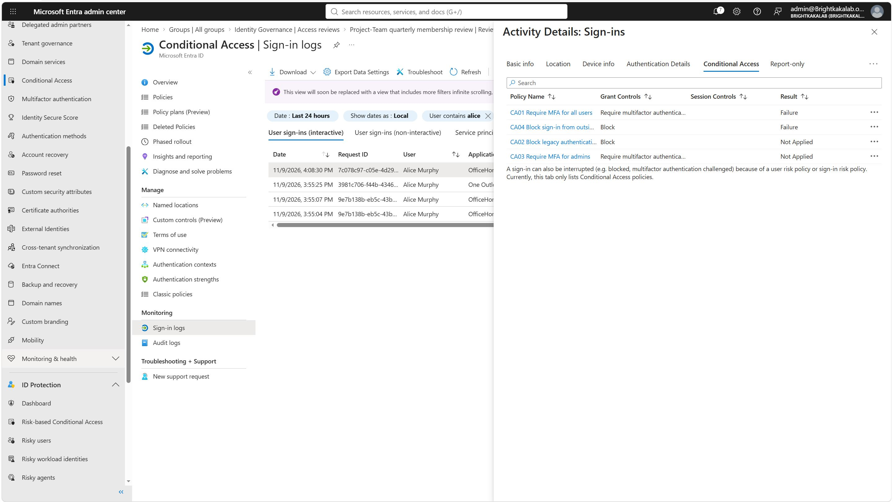

6. After a quiet period, run the impact report for `DYN-Ring2-Broad`, write [CHG-002](docs/changes/CHG-002-enforce-conditional-access-all-users.md), and change CA01 and CA04 to **All users**. Rings stage a rollout; the end state must cover everyone, including accounts with no ring.

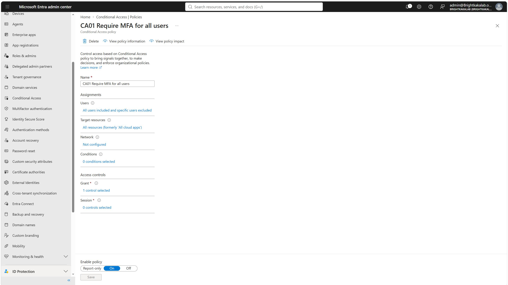


---

## Stage 9: Alert on every break-glass sign-in

**Why:** the accounts that bypass every policy must be watched. Any use is either a drill or an emergency.

**Steps**

1. **Get an Azure subscription into the lab tenant.** Entra can only send its logs to a workspace in a subscription in the **same tenant**. Either sign up for pay-as-you-go while signed in as the lab admin, or create it under a personal account and move it in:
   - Invite the personal account into the lab tenant as a guest, and accept the invitation.
   - New tenants block subscriptions coming in by default ("Subscription entering" policy). As Global Administrator, temporarily turn on **Entra → Overview → Properties → Access management for Azure resources**, then accept the transfer from **Subscriptions → Change directory**.
   - A directory change removes every role assignment: give admin **Owner** on the subscription (time bound), then turn the elevated access **off** again.
2. In that subscription: create resource group `rg-bk-lab-monitoring` and Log Analytics workspace `law-bk-lab-signins` in North Europe. Set a **daily cap** (0.1 GB) and a **EUR 5 budget** alert.
3. **Entra → Monitoring & health → Diagnostic settings → Add**: send **SignInLogs**, **NonInteractiveUserSignInLogs** and **AuditLogs** to the workspace.

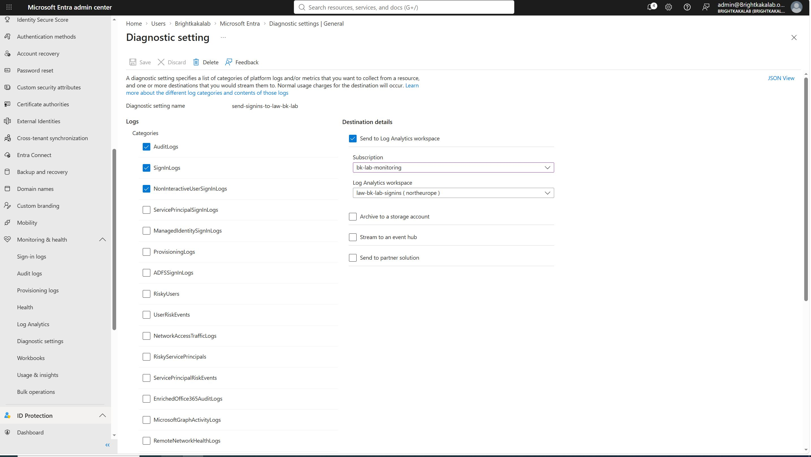

4. In the workspace **Logs** (KQL mode), run [queries/breakglass-signin-detection.kql](queries/breakglass-signin-detection.kql). It reads both sign-in tables, because a stolen token only appears as non-interactive. Expect no results.
5. **New alert rule** from the query: table rows, count, greater than **0**, every **5 minutes**, severity **0**, auto-resolve off. Action group with an **email**, then **verify the email address** on the action group page. An unverified address is silently skipped.

**Check:** sign in as `breakglass01`, sign out, and wait 5 to 15 minutes.

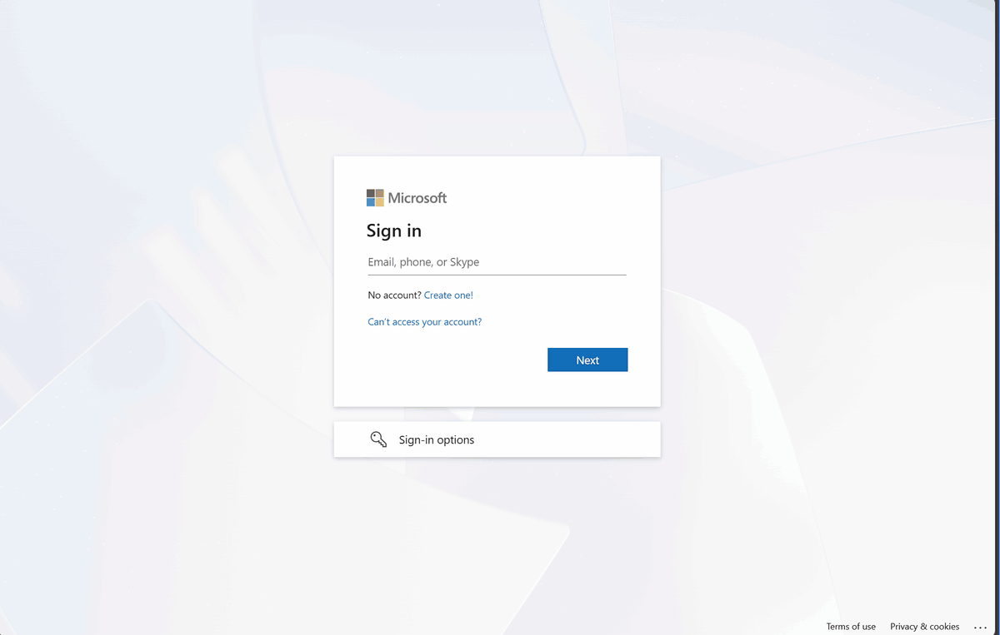


If the query finds background sign-ins from your phone's Authenticator, read the tuning section in [breakglass-monitoring.md](docs/breakglass-monitoring.md) before excluding anything.


---

## Troubleshooting

Problems I hit, and the fix:

| Problem | Fix |
|---|---|
| `Invoke-Pester` says `-Output` is ambiguous | You're in Windows PowerShell 5.1 or the old built in Pester 3.4 loaded. Open PowerShell 7 and run `Import-Module Pester -MinimumVersion 5.5.0` first |
| "...is not digitally signed. You cannot run this script" | Read the script, then `Unblock-File` it. Don't change the execution policy |
| `Connect-MgGraph -UseDeviceCode` fails with 530035 | Security Defaults blocks device code sign-in. Use plain `Connect-MgGraph` |
| A new dynamic group shows 0 members | Membership is processed in the background. Wait and check again before using it |
| A dynamic group has more members than expected | An existing user has the same attribute. List the members to find who |
| Report-only results aren't in the Conditional Access column | That column only shows policies that are On. Open the sign-in and use the Report-only tab |
| Access review stuck on "Applying" | Check the group members. If the denied user is still there, remove them and record why |
| No sign-in data in Log Analytics | Only new sign-ins are sent, and the first data can take up to an hour |
| Alert fires but no email arrives | Verify the email address on the action group page |
| Can't move a subscription into the tenant | The tenant blocks it by default. See Stage 9, step 1 |

## Test results

| Test | What | Result |
|---|---|---|
| T1, T2 | Report-only results for Alice and Bob | Passed |
| T3 | Legacy authentication blocked (What If) | Passed |
| T4 | Admin policy applies only while the PIM role is active | Passed |
| T5 | Sign-in from outside Ireland and the UK blocked, What If and real | Passed |
| T6 | Break-glass sign-in: no policy applies, alert fires | Passed |
| T7 | Compliant device required | After the Intune project |

Automated: 62 Pester tests pass in CI.

## Known limitations

- One person plays requester, approver, admin and user. In a company these are separate people.
- Both break-glass passkeys are on the same phone. Production uses hardware keys kept in separate safes.
- PIM and access reviews rely on a 30 day Entra ID P2 trial.
- Ring 2 contains only disabled synthetic accounts, so the full rollout carries less risk here than in a real company.

## Teardown

When the project ends:

1. Delete the resource group `rg-bk-lab-monitoring` and cancel the `bk-lab-monitoring` subscription.
2. Remove the synthetic users with `./scripts/Remove-LabUsers.ps1` (checks all three synthetic labels before deleting).
3. Delete the dynamic groups and Project-Team.
4. Let the Business Premium and Entra ID P2 trials expire (both set to cancel, nothing is charged).

## Next steps

- CA05 (require a compliant device) after the Intune endpoint project.
- Require phishing resistant MFA for admins through an authentication strength.
- Block device code flow with a Conditional Access policy.

## Repository layout

```
README.md
data/
  synthetic-users.csv           150 fictional staff, departments and rollout rings
  dynamic-groups.json           department and ring group rules
docs/
  ca-policy-plan.md             policy design, test cases, rollout record
  pim-setup.md                  just in time admin access with PIM
  access-review.md              quarterly access review and the stalled auto-apply
  synthetic-users.md            the synthetic workforce: design, safety, results
  dynamic-groups.md             dynamic department and rollout ring groups
  policies-as-code.md           export, CI guardrails and the pull request proof
  breakglass-monitoring.md      Log Analytics alert on any break-glass sign-in
  changes/                      change records CHG-001 and CHG-002
  demos/                        short recordings of key moments
  screenshots/                  cleaned screenshots used as evidence
  evidence/                     test, script and impact report output
queries/
  breakglass-signin-detection.kql   KQL behind the break-glass alert
policies/
  CA01.json ... CA04.json       exported Conditional Access policies (sanitised)
  rollout-approvals.json        approvals required before a policy can be On
scripts/
  New-SyntheticUserData.ps1     builds the CSV (fixed seed, reproducible)
  New-LabUsers.ps1              creates the users through Microsoft Graph
  Remove-LabUsers.ps1           deletes only users carrying all synthetic labels
  New-LabDynamicGroups.ps1      creates the dynamic groups from the JSON
  Export-CAPolicies.ps1         exports the policies as sanitised JSON (read only)
  Get-CAImpactReport.ps1        go/no-go report before enforcing a policy
tests/
  SyntheticUsers.Tests.ps1      checks on the user data
  DynamicGroups.Tests.ps1       runs every group rule against the data
  ConditionalAccess.Tests.ps1   guardrails every policy must pass
.github/workflows/
  test.yml                      style check and all tests on every push and pull request
```

## Author

Bright Amalahu, Systems Administrator
[LinkedIn](https://www.linkedin.com/in/bright-amalahu/) · [Medium](https://medium.com/@brightkakatech) · [GitHub](https://github.com/Brightkakatech)
