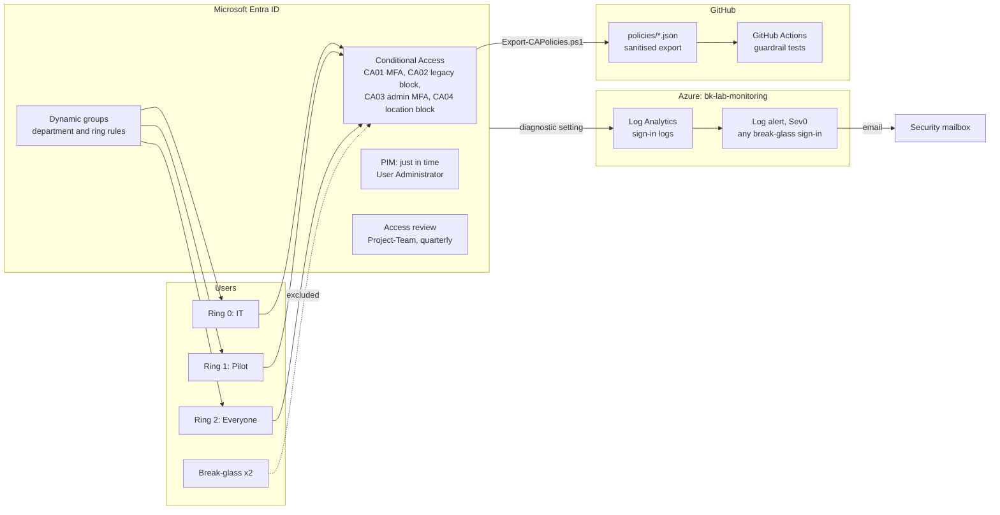

# Zero Trust Identity Lab: Conditional Access, PIM and Access Reviews


## Summary

BrightKaka Tech is a fictional company used for my labs. This project secures sign-ins to its Microsoft 365 tenant using Zero Trust principles: verify every sign-in, give admins power only when they need it, check regularly who still needs access, and watch the accounts that bypass everything.

It was built the way a change would be run in a company of hundreds or thousands of staff: policies tested in report-only mode, an impact report before every enforcement, a staged rollout through rings, change records, and policies kept as code with automated guardrail tests.

| Result | Evidence |
|---|---|
| 4 Conditional Access policies enforced for **all users**, after 8 days in report-only and a two stage rollout | [Policy plan](docs/ca-policy-plan.md), [CHG-001](docs/changes/CHG-001-enforce-conditional-access-ring0-ring1.md), [CHG-002](docs/changes/CHG-002-enforce-conditional-access-all-users.md) |
| MFA enforced from Ireland, sign-in **blocked** from the United States | Recordings below |
| Admin rights only **just in time**: HelpDesk activates User Administrator for 1 hour with MFA, a reason and a ticket | [PIM](docs/pim-setup.md) |
| Quarterly **access review**, with a stalled auto-apply found and fixed | [Access review](docs/access-review.md) |
| **150 synthetic staff** and 11 **dynamic groups** created by script, tested before reaching the tenant | [Users](docs/synthetic-users.md), [Groups](docs/dynamic-groups.md) |
| Policies exported as code, **CI blocks** a change that removes the break-glass exclusion | [Policies as code](docs/policies-as-code.md), [pull request #1](https://github.com/Brightkakatech/zero-trust-identity-lab/pull/1) |
| **Critical alert email** on any break-glass sign-in, tested end to end | [Monitoring](docs/breakglass-monitoring.md) |

## Architecture



## See it working

**MFA enforced:** Alice signs in from Ireland and is asked to approve the sign-in.


**Blocked from abroad:** the same user, through a United States VPN, is blocked (error 53003).


**Just in time admin:** HelpDesk has no admin rights until he activates User Administrator for one hour.


**Guardrail in CI:** a pull request that removes the break-glass exclusion fails the tests.


**Break-glass alert:** an emergency account signs in, and a critical alert email arrives.


## Policy design

The full plan, with the reason for each policy and every test case, is in [docs/ca-policy-plan.md](docs/ca-policy-plan.md).

| ID | Policy | Users | Grant | State |
|---|---|---|---|---|
| CA01 | Require MFA for all users | All users | Require MFA | On |
| CA02 | Block legacy authentication | All users | Block | On |
| CA03 | Require MFA for admins | 13 admin roles | Require MFA | On |
| CA04 | Block sign-in from outside Ireland and the UK | All users | Block | On |
| CA05 | Require compliant device | Pilot first | Compliant device | After the Intune project |

Every policy excludes the group CA-Exclude-BreakGlass. Its two members are cloud only Global Administrators with passkeys, monitored by a critical alert.

## How it was built

1. **Lab tenant and safety net.** Microsoft 365 Business Premium trial (set to cancel on expiry), two break-glass accounts with passkeys, test users and a lockout recovery plan.
2. **Policies in report-only.** CA01 to CA04 created in report-only mode while Security Defaults kept protecting the tenant. Tested with What If and real sign-ins. Error 530035 investigated.
3. **Privileged access.** Entra ID P2 trial, PIM for User Administrator (1 hour, MFA, justification, ticket), and a quarterly access review.
4. **Scale.** 150 synthetic staff from a CSV through Microsoft Graph, 11 dynamic groups for departments and rollout rings.
5. **Policies as code.** Sanitised JSON export, 10 guardrail tests per policy, CI on every push and pull request.
6. **Staged enforcement.** Impact report, then CHG-001 for Ring 0 and Ring 1, verified with recorded sign-ins, then CHG-002 for everyone.
7. **Monitoring.** Sign-in logs to Log Analytics, KQL detection, Sev0 alert with email, tested with break-glass drills.

## Test results

| Test | What | Result |
|---|---|---|
| T1, T2 | Report-only results for Alice and Bob | Passed |
| T3 | Legacy authentication blocked (What If) | Passed |
| T4 | Admin policy applies only while the PIM role is active | Passed |
| T5 | Sign-in from outside Ireland and the UK blocked, What If and real | Passed |
| T6 | Break-glass sign-in: no policy applies, alert fires | Passed |
| T7 | Compliant device required | After the Intune project |

Automated: 62 Pester tests pass in CI (data, groups and policy guardrails).

## What broke and what I learned

- **Security Defaults gives no detail when it blocks a sign-in** (error 530035, "blocked by security defaults"), and cannot be tuned. Conditional Access shows every decision per policy. That lack of visibility is one reason to move away from Security Defaults.
- **Device code sign-in was blocked** by Security Defaults. Device code flow is a common phishing technique, so a normal interactive sign-in was used instead.
- **Admin policies follow the active role, not the person.** CA03 only applied to HelpDesk once his PIM role was active.
- **A recorded decision is not an enforced decision.** The access review showed HelpDesk as denied, but auto-apply stalled for six days and he kept access. Checking the group itself found it.
- **Dynamic rules match everyone with the attribute.** Three groups had one more member than the data predicted, because existing test users had the same department.
- **CI catches what passes locally, and reading the output catches what tests miss.** The first pipeline run failed a style rule, and the first policy export leaked an ID inside Graph metadata. Both now have tests.
- **A failing check does not block a merge without a branch rule.** In production, a ruleset on main would require the guardrail tests to pass.
- **Block always wins.** On a blocked sign-in, Entra ID stops before asking for MFA, so CA01 also shows Failure.
- **The alert fired and still no email was sent,** because the recipient address was unverified. Test the notification path end to end, not just the detection.
- **Passkeys in Authenticator keep break-glass accounts signed in on the phone,** creating background sign-ins that needed a narrow, documented alert exclusion. Hardware FIDO2 keys avoid both this and a browser limitation found earlier.
- **Subscriptions cannot move freely between tenants.** A university tenant blocked a transfer out, and the lab tenant blocked a transfer in until the Global Administrator temporarily elevated.

## Known limitations

- One person plays requester, approver, admin and user. In a company these are separate people.
- Both break-glass passkeys are on the same phone. Production uses hardware keys kept in separate safes.
- PIM and access reviews rely on a 30 day Entra ID P2 trial.
- Ring 2 contains only disabled synthetic accounts, so the full rollout carries less risk here than in a real company.

## Teardown

When the project ends:

1. Delete the resource group `rg-bk-lab-monitoring` and cancel the `bk-lab-monitoring` subscription.
2. Remove the synthetic users with `./scripts/Remove-LabUsers.ps1` (checks all three synthetic labels before deleting).
3. Delete the dynamic groups and Project-Team.
4. Let the Business Premium and Entra ID P2 trials expire (both set to cancel, nothing is charged).

## Next steps

- CA05 (require a compliant device) after the Intune endpoint project.
- Require phishing resistant MFA for admins through an authentication strength.
- Branch ruleset so the guardrail tests are required before merging.
- Block device code flow with a Conditional Access policy.

## Repository layout

```
README.md
data/
  synthetic-users.csv           150 fictional staff, departments and rollout rings
  dynamic-groups.json           department and ring group rules
docs/
  ca-policy-plan.md             policy design, test cases, rollout record
  pim-setup.md                  just in time admin access with PIM
  access-review.md              quarterly access review and the stalled auto-apply
  synthetic-users.md            the synthetic workforce: design, safety, results
  dynamic-groups.md             dynamic department and rollout ring groups
  policies-as-code.md           export, CI guardrails and the pull request proof
  breakglass-monitoring.md      Log Analytics alert on any break-glass sign-in
  changes/                      change records CHG-001 and CHG-002
  demos/                        short recordings of key moments
  evidence/                     test, script and impact report output
queries/
  breakglass-signin-detection.kql   KQL behind the break-glass alert
policies/
  CA01.json ... CA04.json       exported Conditional Access policies (sanitised)
  rollout-approvals.json        approvals required before a policy can be On
scripts/
  New-SyntheticUserData.ps1     builds the CSV (fixed seed, reproducible)
  New-LabUsers.ps1              creates the users through Microsoft Graph
  Remove-LabUsers.ps1           deletes only users carrying all synthetic labels
  New-LabDynamicGroups.ps1      creates the dynamic groups from the JSON
  Export-CAPolicies.ps1         exports the policies as sanitised JSON (read only)
  Get-CAImpactReport.ps1        go/no-go report before enforcing a policy
tests/
  SyntheticUsers.Tests.ps1      checks on the user data
  DynamicGroups.Tests.ps1       runs every group rule against the data
  ConditionalAccess.Tests.ps1   guardrails every policy must pass
.github/workflows/
  test.yml                      style check and all tests on every push and pull request
```

## Author

Bright Amalahu, Systems Administrator
[LinkedIn](https://www.linkedin.com/in/bright-amalahu/) · [Medium](https://medium.com/@brightkakatech) · [GitHub](https://github.com/Brightkakatech)
