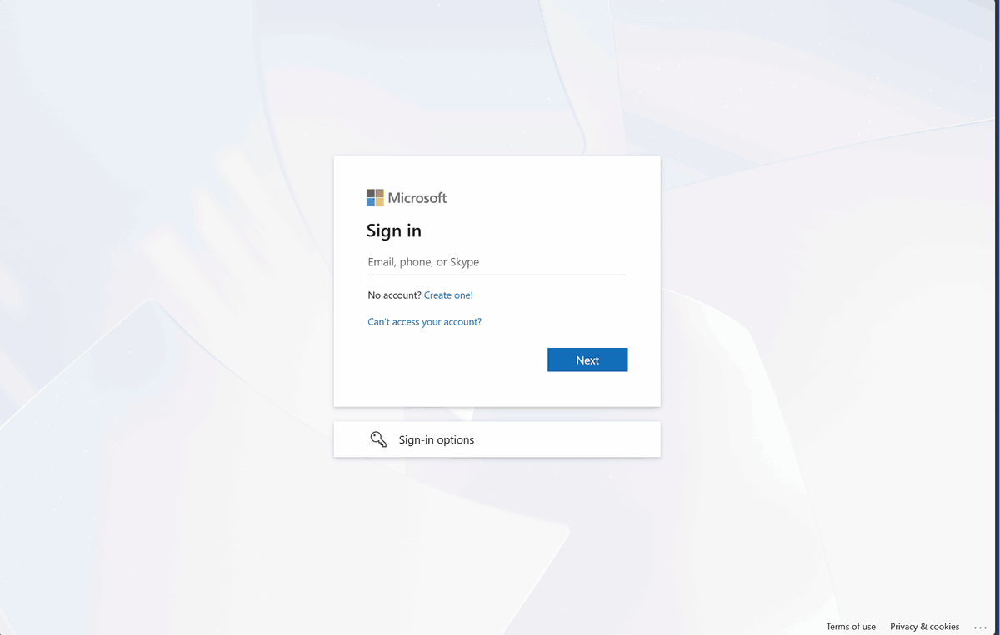
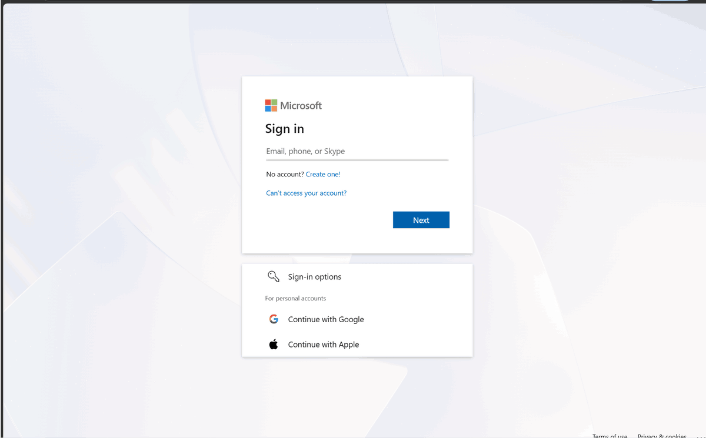

# Break-glass sign-in monitoring

BrightKaka Tech: Zero Trust identity lab
Status: **Live since 2026-11-11.** Tested with a real breakglass01 sign-in, alert email received.

## Why

The two break-glass accounts are excluded from every Conditional Access policy, so they are the most powerful and least restricted accounts in the tenant. Microsoft's guidance is to alert on **any** sign-in by them: every use is either a drill or an emergency, and both must be reviewed. An unexpected alert is treated as a possible compromise.

## Architecture

```
Entra ID sign-in logs
  -> Diagnostic setting (SignInLogs, NonInteractiveUserSignInLogs, AuditLogs)
  -> Log Analytics workspace law-bk-lab-signins (North Europe)
  -> Log alert rule "Break-glass account sign-in" (KQL, every 5 minutes)
  -> Action group ag-bk-lab-security
  -> Email to the security mailbox
```

| Component | Setting | Reason |
|---|---|---|
| Subscription | bk-lab-monitoring, pay-as-you-go, **EUR 5 monthly budget** with alerts at 50% and 100% | Cost control |
| Resource group | rg-bk-lab-monitoring | Everything deleted in one step at teardown |
| Workspace | law-bk-lab-signins, North Europe, 30 day retention, **daily cap 0.1 GB** | Data stays in the EU; the cap stops a log flood from becoming a bill |
| Log categories | SignInLogs, NonInteractiveUserSignInLogs, AuditLogs | Interactive and token-based sign-ins, plus directory changes for later queries |
| Alert rule | Table rows, count, **greater than 0**, every **5 minutes**, **Sev0**, auto-resolve **off** | Any match fires; every alert stays open until someone has reviewed it |
| Action group | ag-bk-lab-security, email to the admin mailbox, subject "CRITICAL: Break-glass account sign-in detected" | In production this would be a shared security mailbox or on-call tool |

## The detection query

[queries/breakglass-signin-detection.kql](../queries/breakglass-signin-detection.kql)

It searches **both** sign-in tables. An attacker using a stolen token never types a password, so the sign-in only appears in the non-interactive table; alerting on interactive sign-ins alone would miss it.

### Tuning: one documented exclusion

The first run of the query found a breakglass01 sign-in nobody had made by hand. Investigation showed it was **non-interactive**, by the **Microsoft Authentication Broker**, on **iOS 18.3.2**: Microsoft Authenticator on the custodian's iPhone refreshing the session it keeps for the device-bound passkey.

Without tuning, this would fire the critical alert several times a day for a harmless reason, and alerts that are always noise end up ignored. The fix excludes **only** that exact pattern (Authentication Broker on iOS). Everything else still fires: any interactive sign-in, and any non-interactive sign-in from another app or device type.

**Trade-off:** a stolen token replayed through the Authentication Broker on an iPhone would not be caught. In production the cause would be removed instead: break-glass credentials on **hardware FIDO2 keys** kept in a safe hold no session anywhere, so no exclusion is needed.

## Test (T6)

| Step | Result |
|---|---|
| Drill 1: breakglass01 signs in with its passkey at 21:34 UTC, then signs out | Sign-in log: success, Conditional Access **notApplied** (excluded as designed). In the workspace about 2 minutes later |
| Alert rule | **Fired 4 times** (21:36, 21:41, 21:46, 22:01 UTC), Sev0. The browser session's background token refreshes also matched until it was signed out |
| Action group | Triggered at 21:36, but **no email arrived** (see findings) |
| Fix | Recipient email verified |
| Drill 2: breakglass01 signs in again at about 23:20 UTC | Alert email **"CRITICAL: Break-glass account sign-in detected"** received in the admin mailbox, Sev0, Fired |

Every break-glass sign-in in this record is a planned drill.

### Recordings

The drill:



The alert email arriving:



## Findings

- **The alert fired, the action group triggered, and still no email was sent.** Azure now requires every email address in an action group to be **verified** before it sends anything. The address showed "Pending", and the notification was skipped without any error on the alert. Detection that nobody hears about is not monitoring. Always test the notification path end to end, not just the query.
- **The alert email arrived with content blocked**, because azure-noreply@microsoft.com was not a safe sender. In production the sender would be on an allow list so security alerts are never filtered.
- **Storing break-glass passkeys in Authenticator creates background sign-ins**, which forced a tuning exclusion. This is a second reason, after the browser limitation found earlier, to use hardware FIDO2 keys for emergency accounts.
- **A single sign-in can produce several alerts** while its session stays open. That is acceptable for an event this rare and serious, and signing out immediately after a drill keeps it to a minimum.

## Getting a subscription into the lab tenant

Log Analytics must sit in a subscription **in the same tenant** as the sign-in logs. Getting one there produced three lessons:

- **University tenants block moving subscriptions out.** An Azure free trial created under a student account could not be transferred: "Your current settings do not allow you to transfer this subscription."
- **New tenants block subscriptions coming in.** Both "Subscription leaving" and "Subscription entering" policies default to "Allow no users (except elevated Global Admins)". The transfer from a personal pay-as-you-go account only completed after the Global Administrator **temporarily elevated** to manage all Azure subscriptions. Elevation was switched off again straight afterwards.
- **A directory change removes every role assignment.** Access was restored by giving admin the **Owner** role, **active and time bound to 2027-01-31** rather than PIM eligible, because the Entra ID P2 trial ends before the project does. In production this would be an eligible PIM assignment.

## Cost

Expected to stay under EUR 2 a month: sign-in data is far below the 5 GB monthly free allowance, and a log alert evaluated every 5 minutes costs roughly EUR 1.50 a month. The resource group is deleted at teardown.
