# Conditional Access policy plan

BrightKaka Tech: Zero Trust identity lab
Status: **CA01 to CA04 On for all users since 2026-11-12 (UTC).** Report-only from 2026-11-01, Ring 0 and Ring 1 from 2026-11-09 under [CHG-001](changes/CHG-001-enforce-conditional-access-ring0-ring1.md), everyone from 2026-11-12 under [CHG-002](changes/CHG-002-enforce-conditional-access-all-users.md). Break-glass accounts excluded and monitored. CA05 follows after the Intune project.

## How to read this plan

Every Conditional Access (CA) policy answers one question:
**"When _these users_ access _these resources_ under _these conditions_, what must happen?"**

| Part of a policy | What it means | Example |
|---|---|---|
| **Users** (assignment) | Who the policy applies to, and who is excluded | All users, except break-glass accounts |
| **Target resources** | Which apps or services | All resources (all cloud apps) |
| **Conditions** | Extra filters | Location, client app type, device platform |
| **Grant** (access control) | What is required, or block | Require MFA, require compliant device, block |
| **State** | Report-only, On or Off | Report-only first, always |

Every policy below excludes the group **CA-Exclude-BreakGlass**, so the emergency accounts can always sign in.

## Test accounts and groups

| Name | Type | Purpose |
|---|---|---|
| alice | Standard user | Pilot user |
| bob | Standard user | Pilot user |
| helpdesk | Admin (via PIM, eligible only) | Tests admin policies and PIM activation |
| breakglass01, breakglass02 | Cloud-only Global Administrators (active permanent, not PIM eligible) | Emergency access, excluded from all CA policies that block or restrict sign-in |
| CA-Exclude-BreakGlass | Security group | Holds both break-glass accounts |
| CA-Pilot-Users | Security group | alice and bob, first rollout target |

## Break-glass account design

Based on Microsoft's guidance, "Manage emergency access accounts in Microsoft Entra ID".

| Decision | Choice | Reason |
|---|---|---|
| Number | Two accounts | Redundancy: if one fails, the other still works |
| Account type | Cloud-only, on the `onmicrosoft.com` domain | No dependency on on-premises AD, federation or a custom domain that could fail |
| Role | Global Administrator, **active permanent** | An eligible (PIM) assignment needs activation, which could fail during an outage |
| Sign-in method | Phishing-resistant MFA: a passkey (FIDO2) | Satisfies Microsoft's mandatory MFA for admin portals, so the accounts still work even though they are excluded from Conditional Access |
| Different method from daily admins | Yes | An outage affecting the admins' usual method (e.g. Microsoft Authenticator) does not also lock out the emergency accounts |
| Not tied to a person | Yes | No personal phone, personal MFA registration or employee device |
| Conditional Access | Excluded through the group CA-Exclude-BreakGlass | One group to manage, instead of editing every policy |
| Monitoring | Alert on **any** sign-in (critical severity) via Log Analytics | Any use is either a drill or an emergency, and both must be reviewed |
| Testing | Sign in every 90 days, and after staff or licence changes | Proves the accounts still work against current policies |
| Credential storage | Passkeys and passwords stored offline, in separate secure places | No single point of loss |

**Lab limitation:** in a real company the FIDO2 keys are hardware keys kept in separate safes. In this lab, each break-glass account uses a device-bound passkey in Microsoft Authenticator, both on the same phone, because no hardware keys were available. This is a deviation from production practice: losing that one phone would lose both emergency methods.

## Policies

| ID | Name | Users | Target resources | Conditions | Grant | Why this policy exists |
|---|---|---|---|---|---|---|
| CA01 | Require MFA for all users | All users, excl. CA-Exclude-BreakGlass | All resources | None | Require MFA | Passwords alone are the most common way accounts are taken over. MFA stops most of these attacks. |
| CA02 | Block legacy authentication | All users, excl. CA-Exclude-BreakGlass | All resources | Client apps: Exchange ActiveSync, Other clients | Block | Legacy protocols (old mail clients, basic auth) cannot do MFA, so they would let attackers bypass CA01. |
| CA03 | Require MFA for admins | Directory roles (see list below), excl. CA-Exclude-BreakGlass | All resources | None | Require MFA | Defence in depth: admins stay protected even if CA01 is changed or someone is excluded from it by mistake. Can later be tightened to phishing-resistant MFA. |
| CA04 | Block sign-in from outside Ireland and the UK | All users, excl. CA-Exclude-BreakGlass | All resources | Locations: include Any, exclude named location "Allowed countries: IE, UK" | Block | BrightKaka Tech staff only work from Ireland and the UK, so sign-ins from elsewhere are suspicious. |
| CA05 | Require compliant device | CA-Pilot-Users first | All resources | Device platform: Windows | Require device to be marked as compliant | Only managed, healthy devices (Intune) can access company data. **Built after Project 5.** |

**Admin roles for CA03:** Global Administrator, Privileged Role Administrator, Security Administrator, Conditional Access Administrator, User Administrator, Helpdesk Administrator, Exchange Administrator, SharePoint Administrator, Intune Administrator, Application Administrator, Cloud Application Administrator, Authentication Administrator, Billing Administrator.

## Test cases and expected results

Report-only results appear on the **Report-only** tab of each sign-in log entry. The possible values are: *Success*, *Failure*, *User action required* (for example, an MFA prompt) and *Not applied*.

| Test | Who | How | Expected report-only result | Actual result | Notes |
|---|---|---|---|---|---|
| T1 | alice | Browser sign-in to office.com from Ireland | CA01: User action required. CA04: Not applied. | CA01: Success. CA02, CA03, CA04: Not applied. | Passed. CA01 showed Success rather than User action required because Alice had just registered and completed MFA in the same session, so her token already carried the MFA claim. CA04 did not apply because the sign-in came from Ireland. |
| T2 | bob | Browser sign-in, MFA completed | CA01: Success | CA01: Success on the completed sign-in. On an earlier attempt without MFA, CA01 showed User action required. CA02, CA03, CA04: Not applied. | Passed. The two entries together show both outcomes of CA01: a sign-in without MFA would be challenged, and a sign-in with MFA is allowed. |
| T3 | alice | What If: client app "Exchange ActiveSync" | CA02: applies, Block | | Real legacy sign-ins are hard to create because Microsoft has already switched off basic authentication for most Exchange Online protocols, so use What If. |
| T4 | helpdesk | Sign-in after activating an admin role in PIM | CA03: User action required or Success | Before activation (00:36 UTC): CA03 Not applied. At activation (00:49 UTC): CA01 and CA03 Success. CA02, CA04: Not applied. | Passed. Same user, 13 minutes apart: with no role, the admin policy did not apply; once User Administrator was active, it did. PIM refreshed the session itself at activation, so no sign out was needed. See [pim-setup.md](pim-setup.md). |
| T5 | alice | What If: location outside Ireland/UK (e.g. United States). Repeated after enforcement as a real sign-in through a US VPN | CA04: applies, Block | What If: CA04 applies. Real sign-in on 2026-11-09: blocked, error 53003, CA04 Failure | Passed. See [Recording 4](demos/04-ca04-vpn-blocked.gif) |
| T6 | breakglass01 | Browser sign-in | No CA policy applies | Real sign-in on 2026-11-11 with passkey: success, Conditional Access notApplied. Critical alert email received | Passed. See [breakglass-monitoring.md](breakglass-monitoring.md) |
| T7 | alice | Sign-in from a compliant Intune device (after Project 5) | CA05: Success | | |

### Evidence

**T1: Alice, completed sign-in. CA01 would allow it, CA02 to CA04 do not apply**

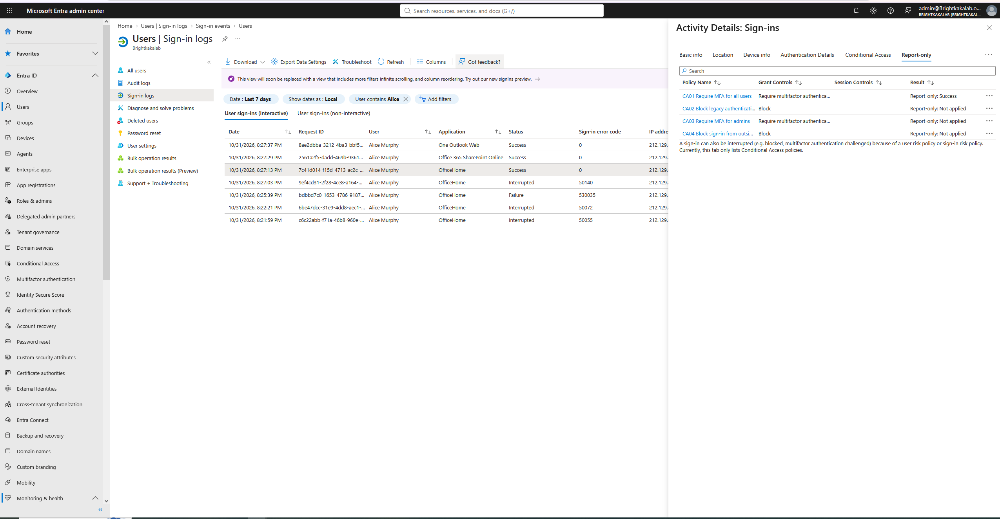

**T2: Bob before MFA. CA01 would ask for MFA**

**T2: Bob after MFA. CA01 would allow it**

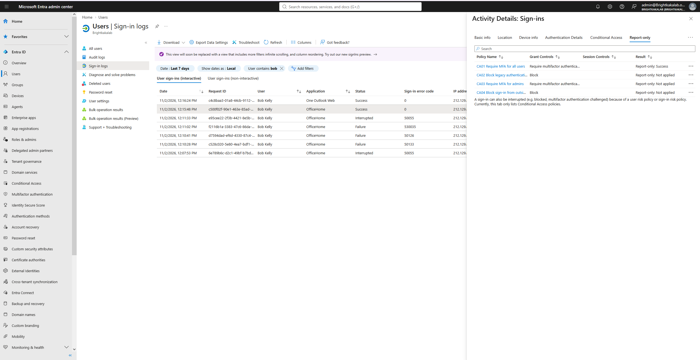

**T5 after enforcement: Alice from the United States, CA04 Failure (block)**

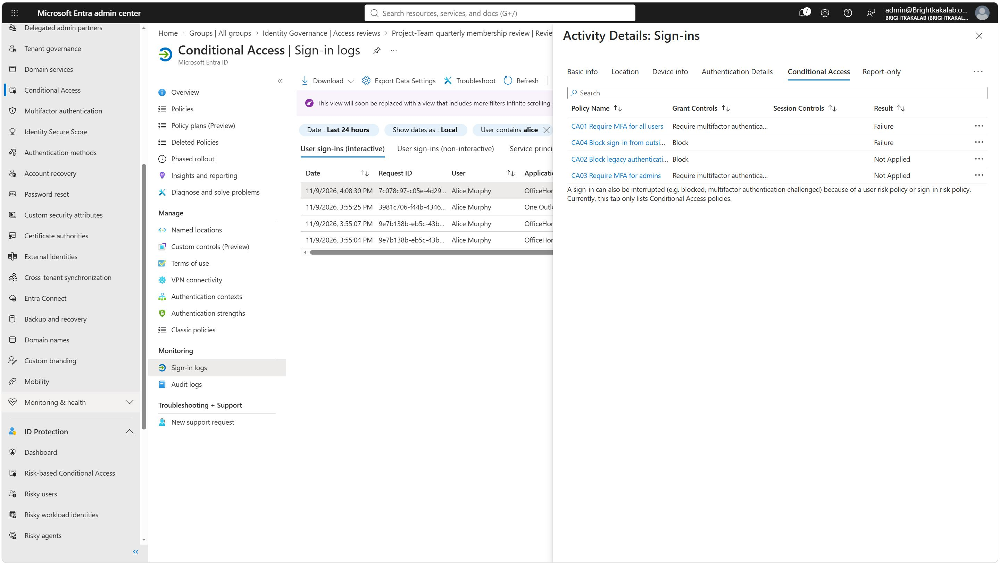

## Rollout record

| ID | Report-only from | Pilot (CA-Pilot-Users) from | Everyone from | Issues found |
|---|---|---|---|---|
| CA01 | 2026-11-01 (UTC) | 2026-11-09 (Ring 0 and Ring 1, CHG-001) | 2026-11-12 (CHG-002) | None |
| CA02 | 2026-11-01 (UTC) | 2026-11-09 (all users from the start, CHG-001) | 2026-11-09 | None |
| CA03 | 2026-11-01 (UTC) | 2026-11-09 (admin roles, CHG-001) | 2026-11-09 (admin roles) | None |
| CA04 | 2026-11-01 (UTC) | 2026-11-09 (Ring 0 and Ring 1, CHG-001) | 2026-11-12 (CHG-002) | None |
| CA05 | | | | |

## What If results

What If simulates a sign-in and shows which policies would apply. Tested with: Office 365 Exchange Online, Windows, Browser, IP 40.77.182.32 (a Microsoft address in the United States), country United States.

| User | Policies that would apply | Policies that would not apply | Result |
|---|---|---|---|
| Alice Murphy | CA01 (require MFA), CA04 (block) | CA02 (client app is a modern browser), CA03 (no admin role) | As designed. When several policies apply, all their controls are required and Block always wins, so this sign-in would be blocked. |
| Emergency Access 01 | None | All four, reason "Users and groups" (excluded) | As designed. The break-glass account is unaffected even from a blocked country. Users are evaluated first, so the exclusion alone protects it. |

## Screenshots: the build

**Starting point: Security Defaults on**

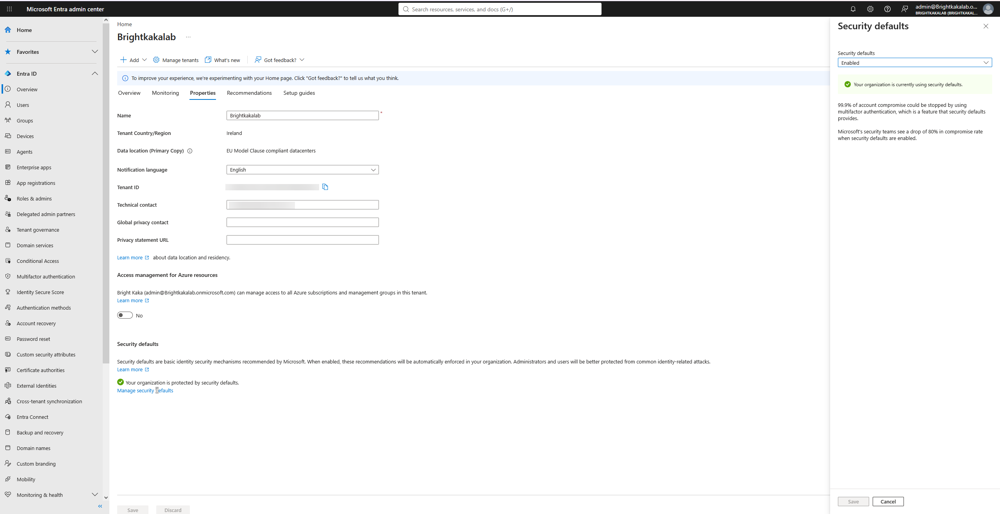

**The two break-glass accounts, cloud only**

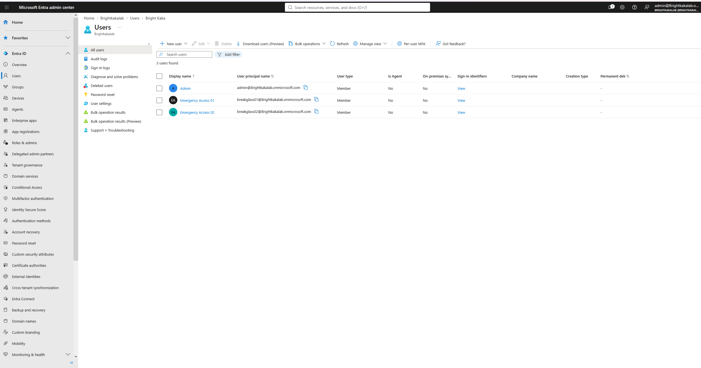

**CA-Exclude-BreakGlass, the one group every policy excludes**

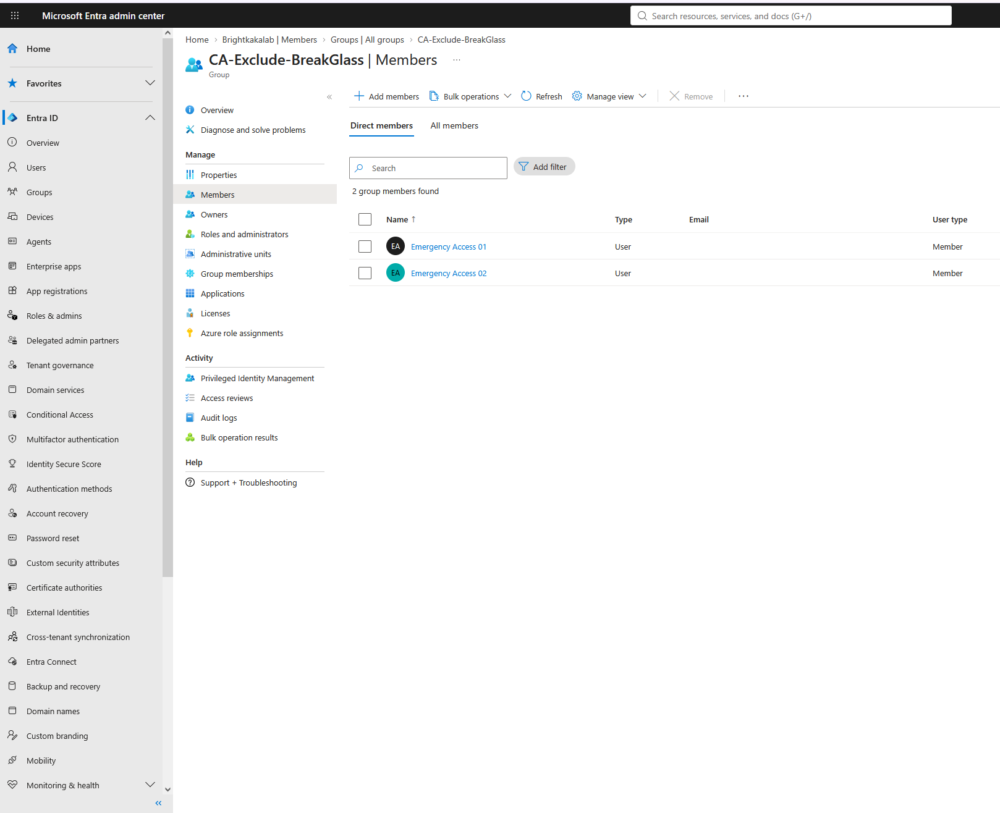

**Passkey (FIDO2) authentication method policy**

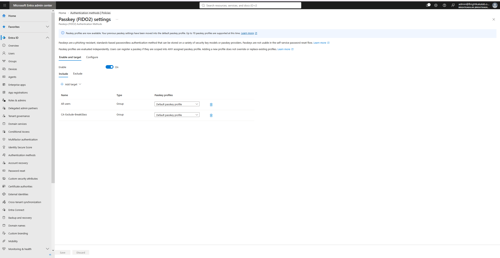

**Passkey registered for an emergency account**

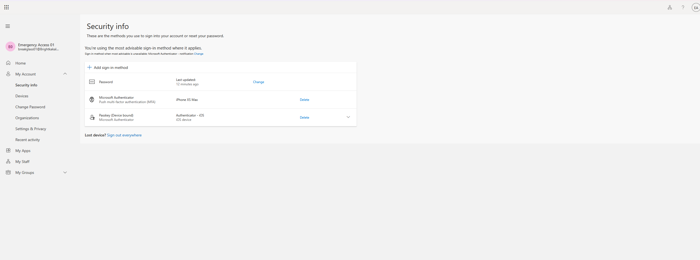

**Test users and licences**

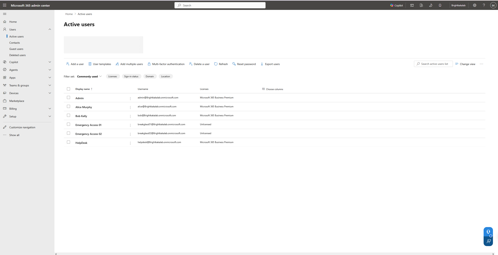

**Named location used by CA04: Ireland and the UK**

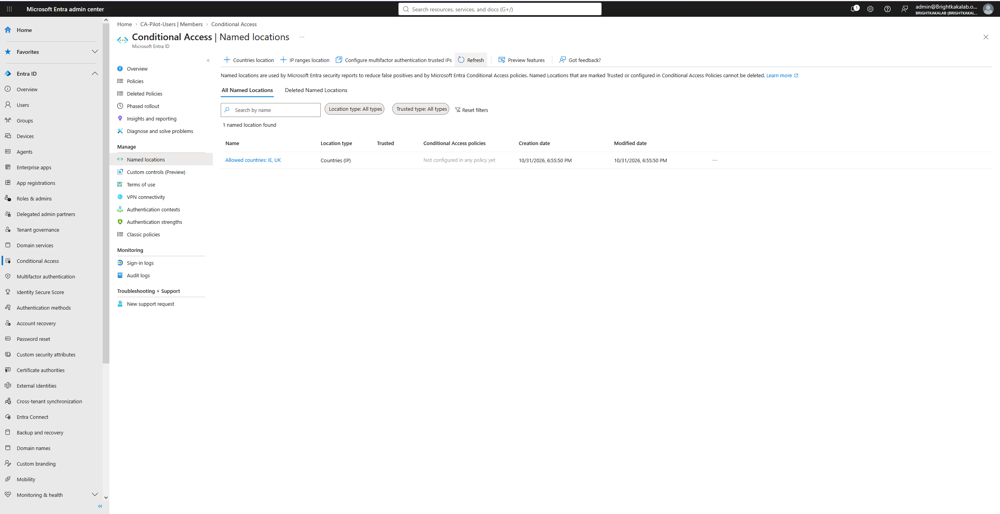

**The portal offers to exclude the signed-in admin; declined, because lockout protection comes from break-glass**

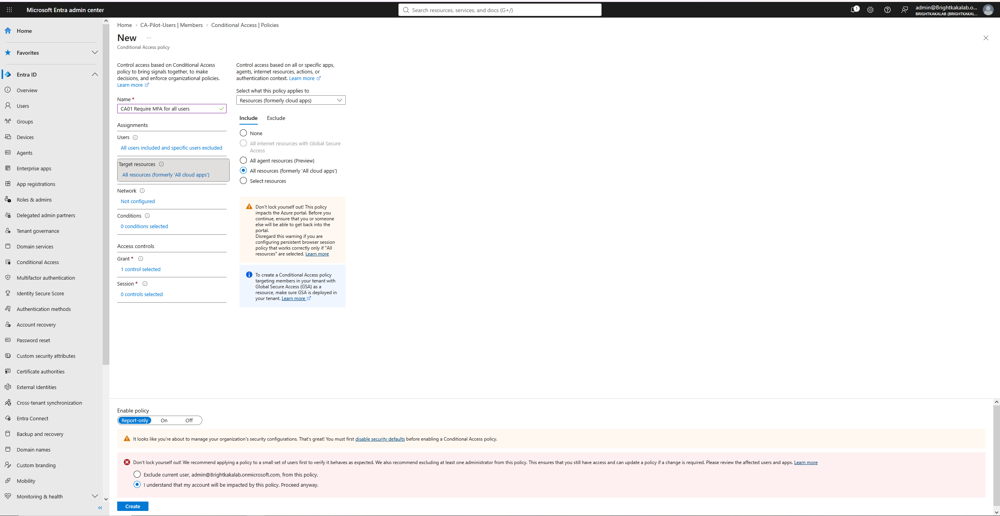

**CA01 to CA04 created in report-only mode**

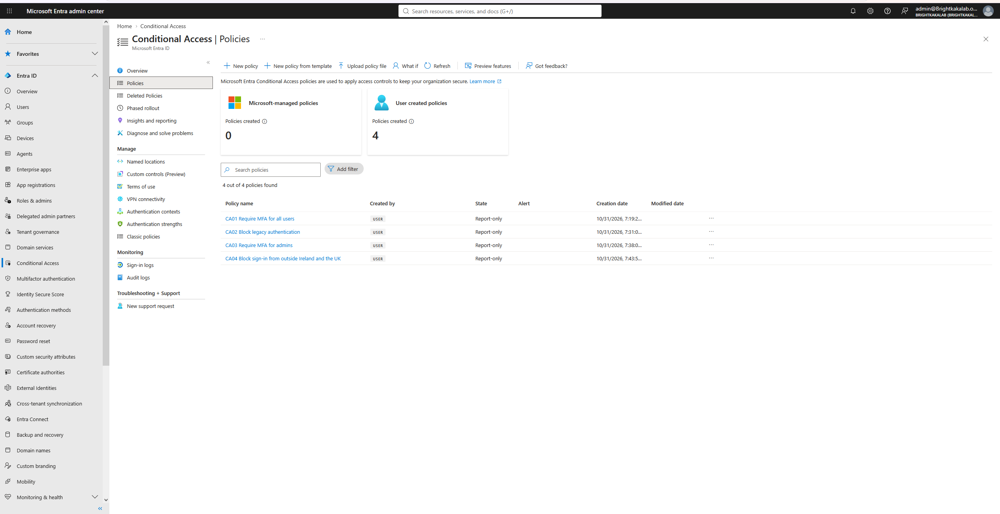

**What If: Alice from the United States, CA01 and CA04 apply**

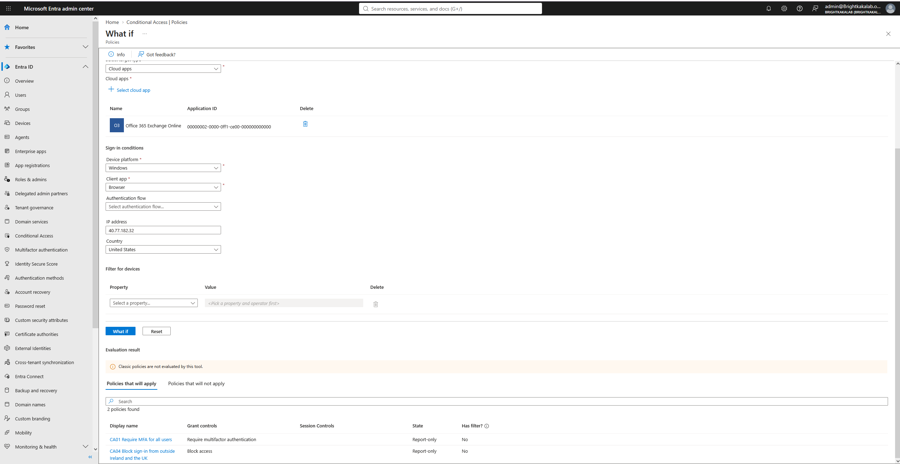

**What If: break-glass account, no policy applies**

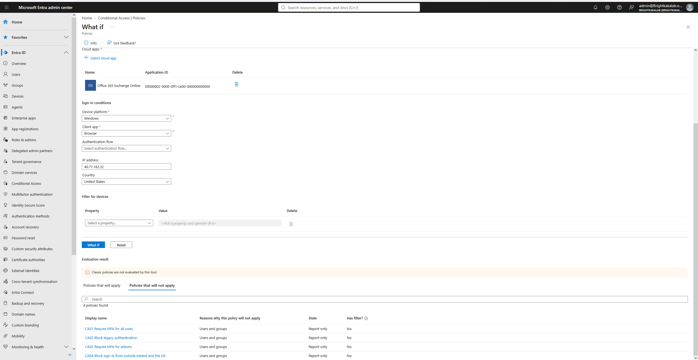

## Findings during the build

- **Report-only policies can run alongside Security Defaults.** The portal only requires Security Defaults to be disabled before a policy is switched **On**. Security Defaults therefore kept protecting the tenant during the report-only phase, with no unprotected gap.
- **The portal offered to exclude the signed-in admin from each policy** to prevent lockout. This was declined: lockout protection comes from the dedicated, monitored break-glass accounts, and the daily admin account must stay covered by every policy.
- **Passkeys are enabled for all users by default** in new tenants (passkey profiles). No separate passkey policy was needed for the break-glass accounts.
- **Passkey sign-in depends on the browser.** On the Windows 10 host, Firefox only offered a USB security key, while Edge allowed signing in with the phone passkey. In production, hardware FIDO2 keys are recommended for break-glass accounts because they work in any browser.

## A new user's first sign-in, read from the logs

Each test user's first sign-in produced a chain of sign-in log entries. Each code explains one step:

| Error code | Status | Meaning | Seen for |
|---|---|---|---|
| 50055 | Interrupted | The temporary password had expired, so a new one had to be set | Alice, Bob |
| 50133 | Failure | The session was no longer valid because the password had just been changed | Bob |
| 50126 | Failure | Wrong username or password | Bob |
| 50072 | Interrupted | An MFA method had to be registered | Alice |
| 530035 | Failure | An attempt was blocked by Security Defaults | Alice, Bob |
| 50140 | Interrupted | The "Stay signed in?" prompt | Alice |
| 0 | Success | Signed in | Alice, Bob |

**Investigating 530035.** The code appeared for both users at the same stage of their first sign-in, and the next attempt succeeded both times. The sign-in log's failure reason was only: "Access has been blocked by security defaults." The additional details said: "If this is unexpected, see security defaults that applied to this request in the Azure Portal." The Security Defaults page is a single on/off switch with no per-rule detail. Microsoft's description of AADSTS530035 gives two causes: the request used legacy authentication, or Security Defaults judged it unsafe. Both sign-ins were from a modern browser to OfficeHome, so legacy authentication is ruled out, which leaves the "deemed unsafe" check on a brand new account. Security Defaults does not say which rule fired and offers no settings to adjust or exclude it. That lack of visibility and control is one of the reasons organisations replace Security Defaults with Conditional Access, where every decision is listed per policy on the sign-in entry.

**The "Conditional Access" column in the sign-in log only reflects policies that are On.** While policies are in Report-only, that column shows "Not Applied" for everyone, and the real evaluation is on the **Report-only** tab of each entry.

## Lockout recovery plan

1. Keep one browser window signed in as a Global Administrator for the whole testing session.
2. If a policy locks users out, sign in with **breakglass01** (excluded from every policy) and set the policy to Report-only or Off.
3. Check the sign-in log entry for the failed user to see which policy blocked them.
4. Every sign-in by a break-glass account is investigated (see the optional alert in the README).
