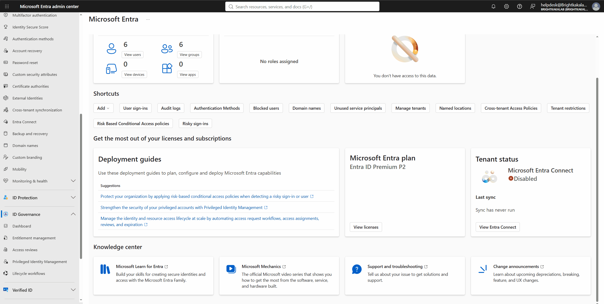
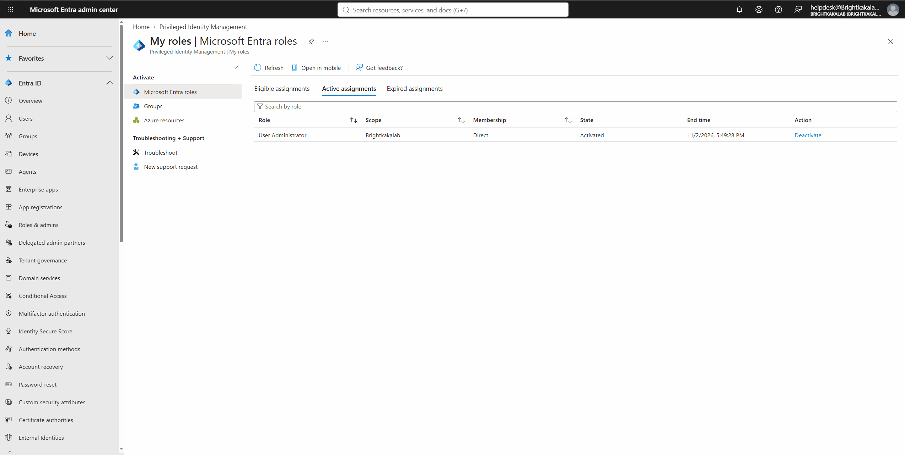
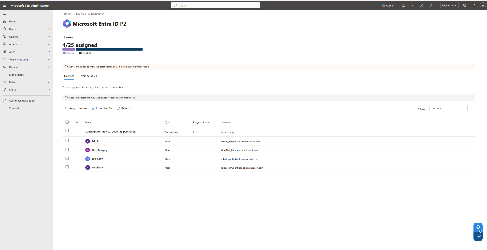
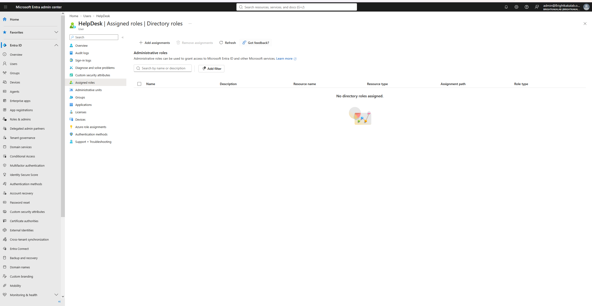
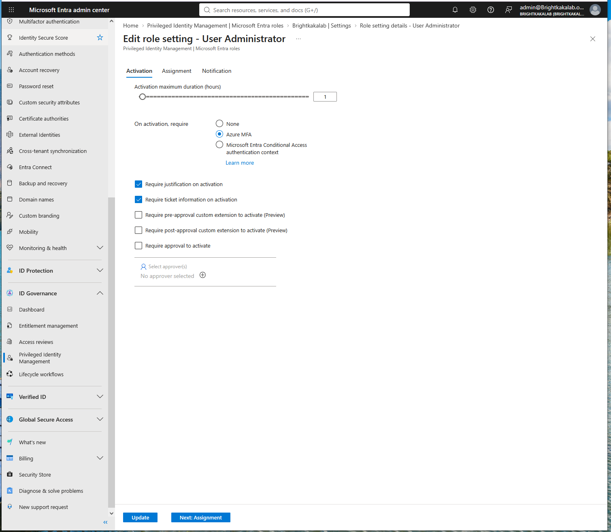
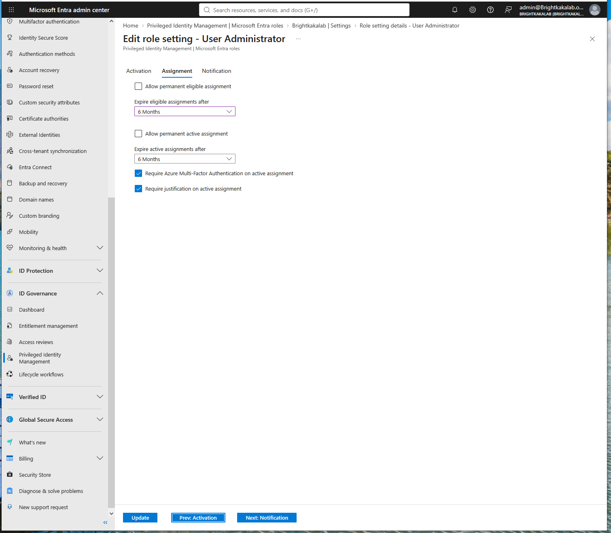
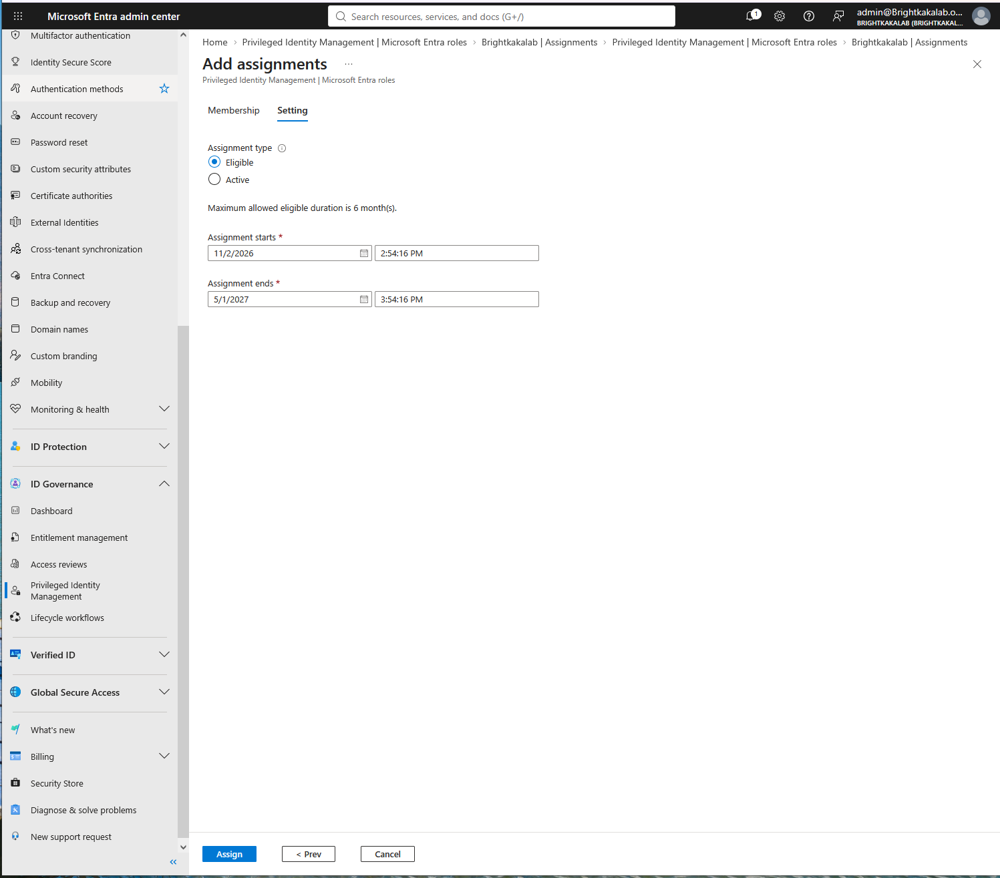
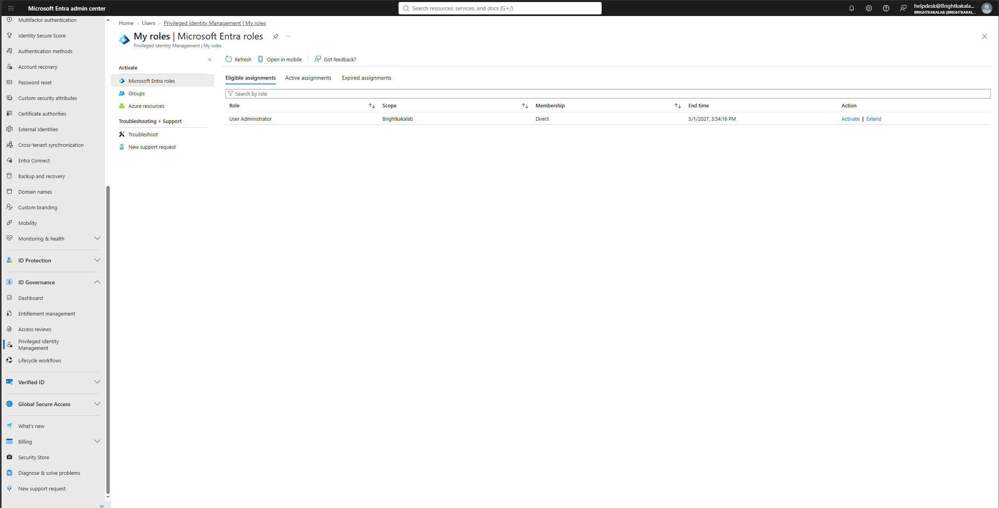
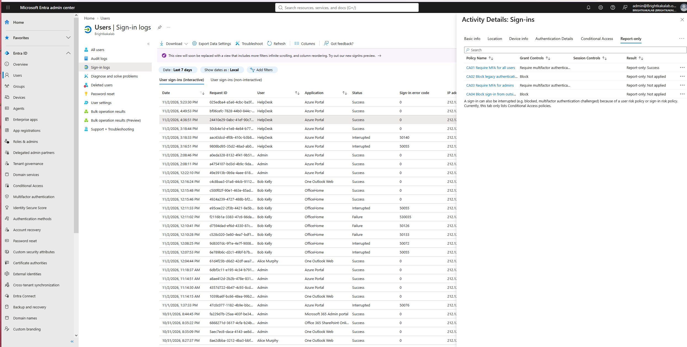
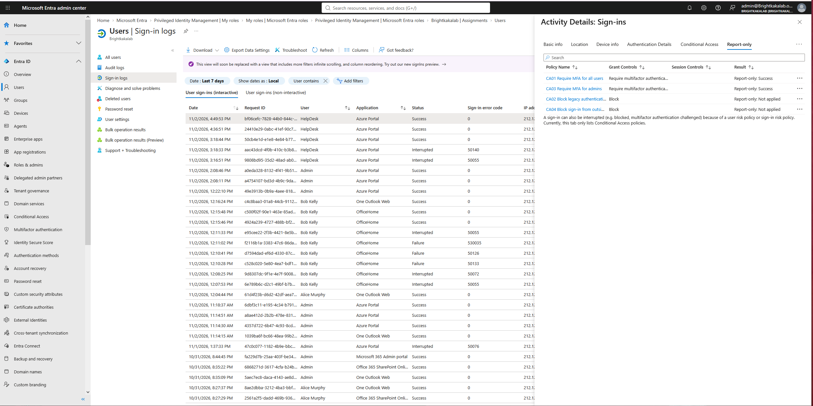

# Privileged Identity Management (PIM)

BrightKaka Tech: Zero Trust identity lab
Status: **User Administrator is eligible only for HelpDesk since 2026-11-02 (UTC).** First activation tested and recorded.

## The problem PIM solves

An admin role that is always active is always available to an attacker. If a helpdesk account's password is stolen, a permanent User Administrator role lets the attacker reset passwords and take over other accounts at any time.

With PIM, HelpDesk is **eligible** for the role but does not hold it. He activates it only when a task needs it, proves who he is, says why, and the role removes itself after one hour. This is called **just in time access**.

## Licensing

PIM requires Microsoft Entra ID P2. Business Premium includes P1 only, so a 30 day Entra ID P2 trial was added (25 licences, 2026-11-02 to 2026-12-01).

| Decision | Choice | Reason |
|---|---|---|
| Trial renewal | Cancel on expiration | The trial converts to a paid subscription by default. Renewal was switched off straight after activation, so nothing is charged when it ends. |
| Licences assigned | Admin, HelpDesk, Alice, Bob (4 of 25) | Only the people who use PIM or take part in access reviews |
| Break-glass accounts | No licence | Emergency access must not depend on any licence that could expire or change |

## Role settings: User Administrator

In PIM, rules belong to the **role**, so everyone made eligible for it later follows the same rules.

### Activation

| Setting | Value | Why |
|---|---|---|
| Activation maximum duration | 1 hour | Admin rights expire quickly |
| On activation, require | Azure MFA | Proves it is really the user |
| Require justification | On | Every use is explained in the audit log |
| Require ticket information | On | Links every use to a support ticket |
| Require approval | Off | Kept simple for the first test. A second approver can be added for higher risk roles. |

### Assignment

| Setting | Value | Why |
|---|---|---|
| Allow permanent eligible assignment | Off | Eligibility must be renewed, so access is not kept forever by forgetting |
| Expire eligible assignments after | 6 months | Forces a regular check of who still needs it, alongside access reviews |
| Allow permanent active assignment | Off | Nobody gets always on rights through this role |
| Require MFA on active assignment | On | An admin giving direct active access must also prove who they are |
| Require justification on active assignment | On | Every direct assignment is explained |

## Assignment

| User | Role | Type | Ends |
|---|---|---|---|
| HelpDesk | User Administrator | Eligible | 2027-05-01 |

Before the assignment, HelpDesk had **no directory roles**.

## Activation test

| Step | Result |
|---|---|
| Before activation | Entra home page shows "No roles assigned". My roles lists User Administrator under Eligible only. |
| Activation request | Duration 1 hour, ticket system ServiceDesk, ticket INC-001, reason "Reset password for Bob Kelly" |
| Activation | Stages 1 to 3 completed successfully |
| After activation | Active assignments shows User Administrator, state Activated, ending one hour later. The home page shows one role assignment. |
| Conditional Access (test T4) | Sign-in at 00:36 UTC, before activation: CA03 "Require MFA for admins" Not applied. Sign-in at 00:49 UTC, at activation: CA03 Success. PIM refreshed the session itself, so no sign out was needed. |

### Recordings

## Screenshots

**Entra ID P2 trial: 4 of 25 licences, only where needed**

**Before: HelpDesk has no directory roles**

**Activation rules: 1 hour, MFA, justification, ticket**

**Assignment rules: no permanent assignments, eligibility expires after 6 months**

**HelpDesk made eligible, not active**

**HelpDesk view: User Administrator under Eligible**

**T4 before activation: CA03 Not applied**

**T4 at activation: CA03 Success**

## Findings

- **No second MFA prompt on activation.** HelpDesk had completed MFA when signing in a few minutes earlier, and PIM accepted that existing proof. "Azure MFA" on activation does not guarantee a fresh prompt. To force a fresh, stronger check on every activation, PIM can instead require a **Conditional Access authentication context**, linked to a policy that demands, for example, phishing resistant MFA.
- **Admin policies follow the role, not the person.** CA03 only applied to HelpDesk once his role was active, which is why CA01 (all users) is still needed as a baseline.
- **"Add assignments" on a user's Assigned roles page gives a permanent active role.** It bypasses PIM entirely. Eligible assignments must be made from PIM.

## Still to do

- ~~Access review on the Project-Team group~~ Done, see [access-review.md](access-review.md)
- Alert on PIM activations of high privilege roles
