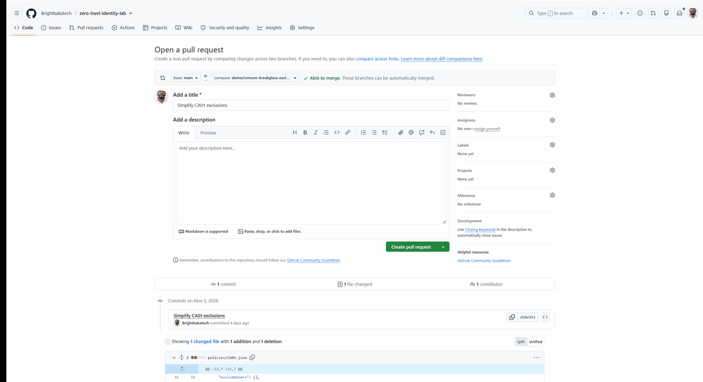
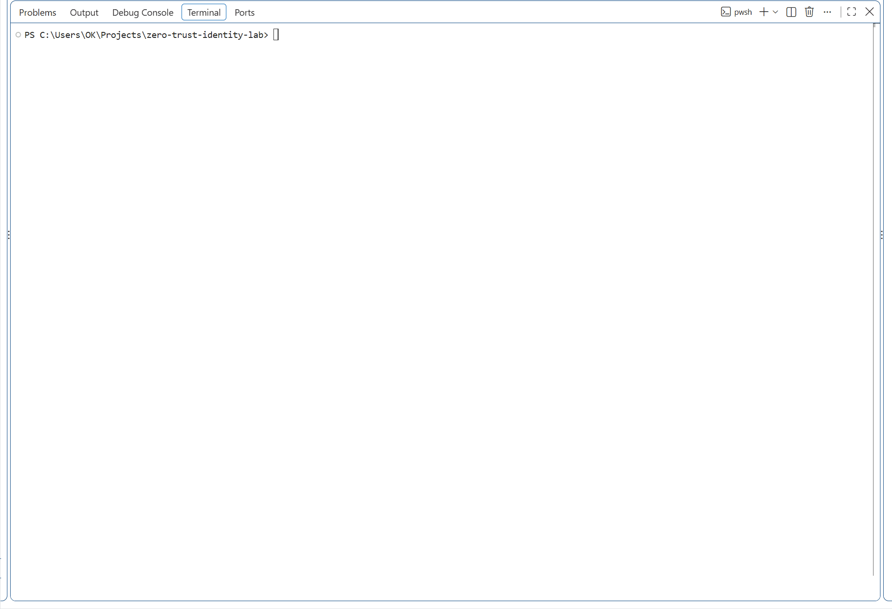
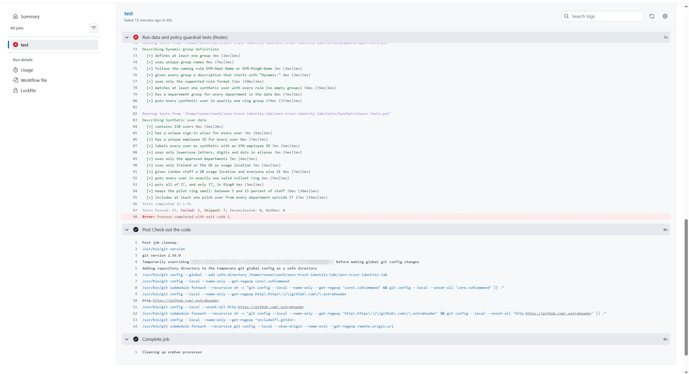
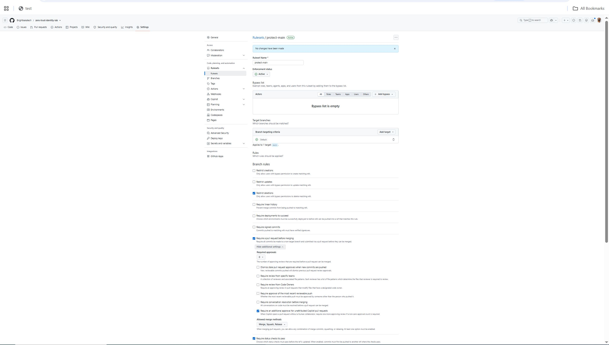

# Conditional Access policies as code

BrightKaka Tech: Zero Trust identity lab
Status: **CA01 to CA04 exported and guarded by CI since 2026-11-05.** Guardrail proven on [pull request #1](https://github.com/Brightkakatech/zero-trust-identity-lab/pull/1).

## The problem

Conditional Access policies normally live only in the portal. If an admin edits one badly, for example removes the break-glass exclusion while "tidying up", nothing warns anyone. The mistake is found during an outage, when the emergency accounts are locked out with everyone else.

## The approach

1. **Export** every policy to a JSON file in [policies/](../policies), so Git records every change: who, when, and exactly which line.
2. **Test** every file against the rules the organisation cares about.
3. **Run the tests automatically** in GitHub Actions on every push to `main` and every pull request. A change that breaks a rule turns the build red before it is accepted.

### Export

[scripts/Export-CAPolicies.ps1](../scripts/Export-CAPolicies.ps1) reads the policies through Microsoft Graph with read only permissions (`Policy.Read.All`, `Directory.Read.All`) and writes one file per policy. Before saving, it sanitises the export so it is safe to publish:

| Raw Graph value | In the published file |
|---|---|
| Group object ID | `group:CA-Exclude-BreakGlass` |
| Named location ID | `namedLocation:Allowed countries: IE, UK` |
| Directory role template ID | `role:Global Administrator` |
| Policy ID, created and modified timestamps | Removed |
| `@odata` metadata, which contains the policy ID | Removed at every level |

Readable names also make every pull request easy to review: a diff shows `group:CA-Exclude-BreakGlass` being removed, not an anonymous ID.

### Guardrails

[tests/ConditionalAccess.Tests.ps1](../tests/ConditionalAccess.Tests.ps1) checks every policy file:

| Guardrail | Why |
|---|---|
| Named `CAnn Description` and matches its file name | Policies can be found and referred to without ambiguity |
| **Excludes the break-glass group** | Emergency access accounts must never be locked out |
| Never includes the break-glass group | Same reason, from the other direction |
| Report-only or On, never left disabled | A disabled policy protects nobody and hides in the list |
| **On only with an approval** in [rollout-approvals.json](../policies/rollout-approvals.json): at least 7 days of report-only, an approver and a change reference | Change control: nothing is enforced without evidence and sign off |
| No tenant object IDs outside the application list, no `@odata` metadata, no unresolved names | The export stays safe to publish and complete |
| Has a grant control | A policy that requires nothing does nothing |
| A location block must exclude at least one location | A block on all locations with no exclusion locks out everyone |

The same pipeline also runs PSScriptAnalyzer on every script and the 20 data tests for the synthetic users and dynamic groups. Result when the policies were first exported in report-only: **58 passed, 0 failed, 7 skipped** (skips are rules that only apply to policies that are On or block by location, and each says why). After enforcement, the approval tests run for every policy: **62 passed, 0 failed, 3 skipped** ([pester-after-enforcement.txt](evidence/pester-after-enforcement.txt)).

## Proof: the guardrail stops a bad change

To prove the guardrail works, a deliberately harmful change was proposed as a pull request: the break-glass group was removed from CA01's exclusions, with the innocent sounding title "Simplify CA01 exclusions".

| Step | Result |
|---|---|
| Pull request opened | CI started automatically |
| CI result | **Failed after 40 seconds: 57 passed, 1 failed** |
| Failing test | `[-] excludes the break-glass group` on CA01, "because emergency access accounts must never be locked out" |
| Fix pushed to the same pull request | Exclusion restored, CI **passed** |
| Outcome | Pull request closed without merging. `main` never contained the bad change. |

### Recordings

The bad change is rejected:

The fix passes:

**The failed check on pull request #1: one test failed on CA01**

## What I learned

- **CI catches what passes locally.** The first pipeline run failed on a PSScriptAnalyzer rule (a function name read as plural) that never ran on my PC. The fix was a rename, and the history shows run 1 red and run 2 green.
- **Read the export, do not just trust the tests.** The first export contained an `@odata.context` line with the policy ID, and my first test only checked the user and location sections, so it would have passed. The export now strips all `@odata` properties, and a new test checks the whole file.
- **A report is not a block.** GitHub reported the failing check, but the Merge button stayed clickable. I added a branch ruleset on `main`: every change needs a pull request, the `test` check must pass, and the bypass list is empty, so not even the repository admin can skip it. This change to the documentation was the first one to go through it.

**The ruleset on `main`**

